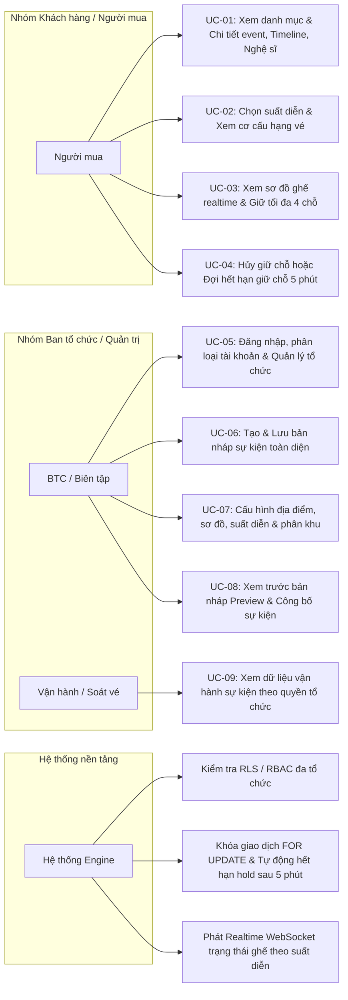
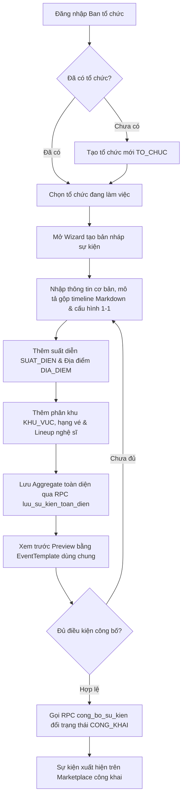
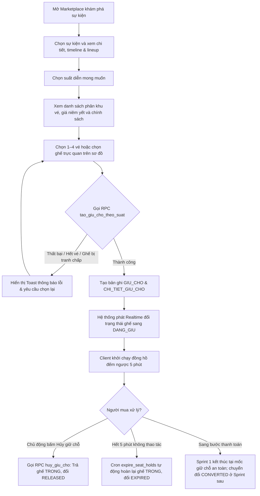
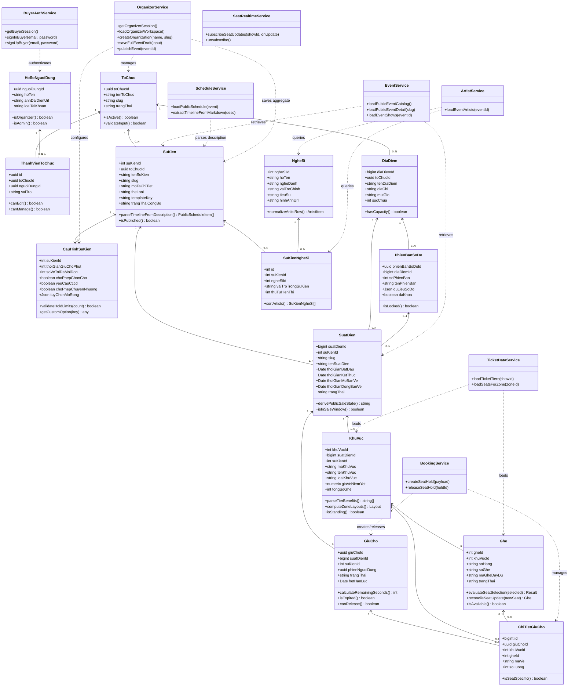
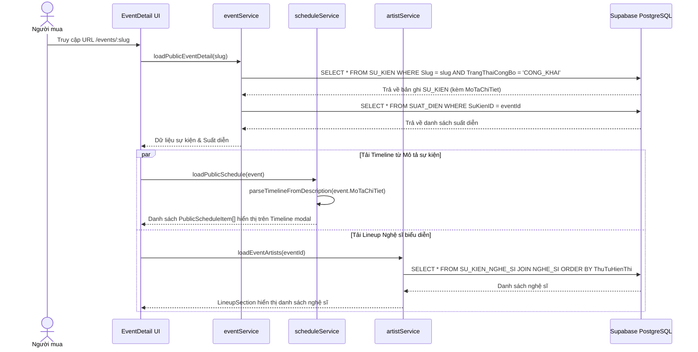
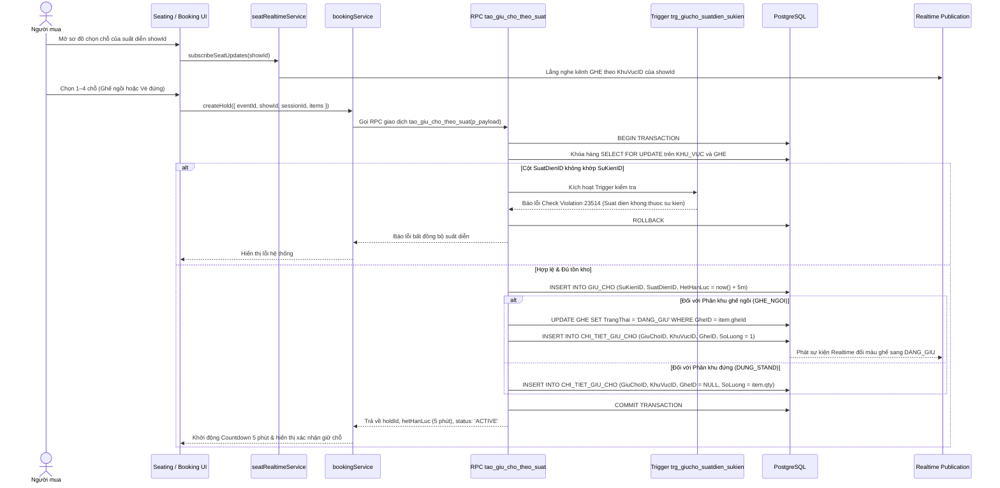
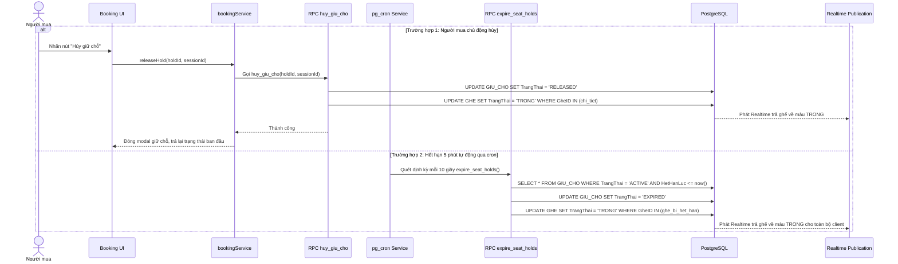
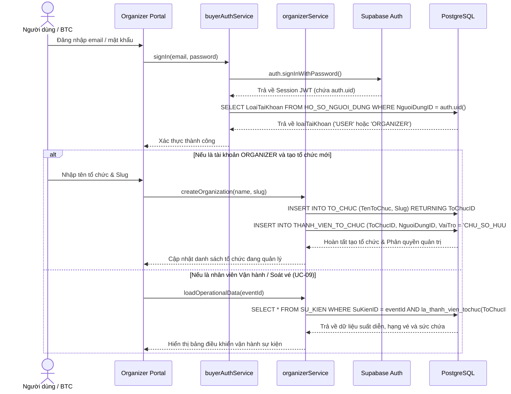
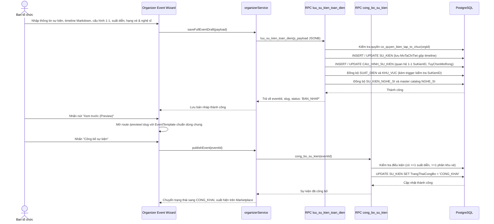
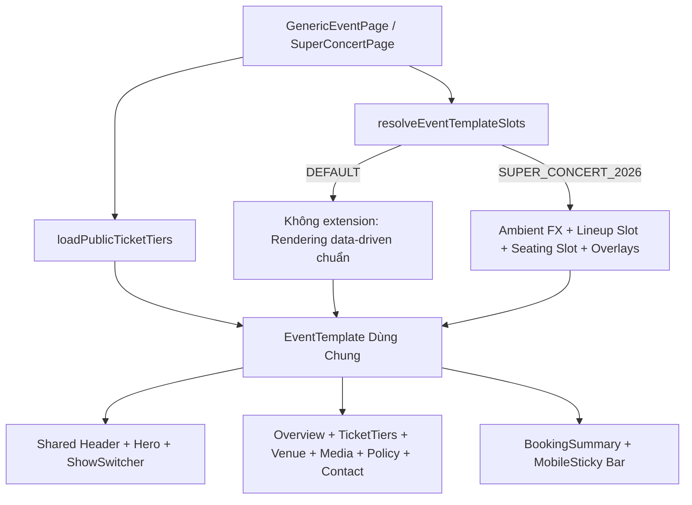

# 02 — Phân tích và thiết kế hệ thống

## 1. Use case tổng quan và danh mục Use Case

Hệ thống EventTicketing được phân tách thành 3 nhóm tác nhân chính (`Người mua`, `Ban tổ chức / Biên tập`, `Vận hành / Soát vé`) và hệ thống nền tảng.



### Bảng danh mục Use Case chuẩn hóa

| Mã Use Case | Tên Use Case | Tác nhân chính | Phạm vi dữ liệu & Nghiệp vụ cốt lõi |
|---|---|---|---|
| **UC-01** | Xem danh mục & Chi tiết sự kiện | Người mua | Tải thông tin sự kiện `SU_KIEN`, bóc tách timeline từ `MoTaChiTiet` **[Chú thích 3]**, tải lineup nghệ sĩ từ `SU_KIEN_NGHE_SI` và `NGHE_SI`. |
| **UC-02** | Chọn suất diễn & Xem cơ cấu hạng vé | Người mua | Tải danh sách suất diễn `SUAT_DIEN`, thông tin phân khu / giá vé từ `KHU_VUC`. |
| **UC-03** | Xem sơ đồ ghế Realtime & Giữ chỗ 5 phút | Người mua | Nhận luồng Realtime `GHE`, gọi RPC `tao_giu_cho_theo_suat` tạo `GIU_CHO`, `CHI_TIET_GIU_CHO` (phân biệt ghế ngồi và vé đứng **[Chú thích 2]**). |
| **UC-04** | Hủy / Hết hạn giữ chỗ | Người mua / Hệ thống | Giải phóng ghế đang giữ về `TRONG`, đổi trạng thái `GIU_CHO` sang `RELEASED` hoặc `EXPIRED` qua cron `expire_seat_holds`. |
| **UC-05** | Đăng nhập & Quản lý tổ chức / RBAC | Ban tổ chức | Xác thực Supabase Auth, phân loại `LoaiTaiKhoan` trên `HO_SO_NGUOI_DUNG`, quản lý `TO_CHUC` và quyền `THANH_VIEN_TO_CHUC`. |
| **UC-06** | Tạo & Lưu sự kiện toàn diện | Ban tổ chức | Lưu aggregate trong 1 transaction qua RPC `luu_su_kien_toan_dien`: `SU_KIEN`, cấu hình 1–1 `CAU_HINH_SU_KIEN`, timeline Markdown, lineup nghệ sĩ. |
| **UC-07** | Cấu hình địa điểm, sơ đồ & phân khu | Ban tổ chức | Thiết lập thông tin `DIA_DIEM`, sơ đồ `PHIEN_BAN_SO_DO`, suất diễn `SUAT_DIEN` và phân bổ phân khu `KHU_VUC`, ghế `GHE`. |
| **UC-08** | Xem trước bản nháp & Công bố | Ban tổ chức | Kiểm tra tính sẵn sàng `kiem_tra_dieu_kien_cong_bo`, mở route Preview bảo mật và gọi RPC `cong_bo_su_kien`. |
| **UC-09** | Tra cứu dữ liệu vận hành sự kiện | Vận hành / Soát vé | Kiểm tra quyền thành viên tổ chức `la_thanh_vien_tochuc`, xem danh sách khán đài, suất diễn và số lượng vé phát hành. |

---

## 2. Activity — Luồng Ban tổ chức tạo và công bố sự kiện



---

## 3. Activity — Luồng Người mua xem vé và giữ chỗ



---

## 4. Kiến trúc logic 3 lớp (Logical Architecture)

```mermaid
flowchart TB
  subgraph ClientLayer[Tầng Trình bày (React 19 / Vite Client)]
    R[App Router]
    MP[Marketplace / Catalog View]
    EP[EventTemplate dùng chung đa sự kiện]
    EX[Extension Slots: Lineup / Seating Map / Timeline Dialog]
    OP[Organizer Portal & Event Creation Wizard]
    RO[React Runtime Overlays: Tooltip / Toast / Hold Modal]
    R --> MP
    R --> EP
    EP --> EX
    EP --> RO
    R --> OP
  end

  subgraph ServiceLayer[Tầng Dịch vụ & Domain Logic (src/services & src/domain)]
    BAS[BuyerAuthService: Đăng nhập & Session người mua]
    OS[OrganizerService: Quản trị tổ chức & Lưu Aggregate sự kiện]
    ES[EventService: Truy vấn danh mục sự kiện & Suất diễn]
    SS[ScheduleService: Bóc tách Timeline từ Description]
    AS[ArtistService: Chuẩn hóa & Sắp xếp Lineup nghệ sĩ]
    TDS[TicketDataService: Truy vấn phân khu & hạng vé]
    BS[BookingService: Điều phối Giữ chỗ & Khóa ghế 5 phút]
    SRS[SeatRealtimeService: WebSocket quản lý trạng thái ghế]
  end

  subgraph SupabaseLayer[Tầng Dữ liệu & Nền tảng Cloud (Supabase / PostgreSQL 15+)]
    AUTH[Supabase Auth: Quản lý danh tính auth.users]
    DB[(14 Bảng CSDL Schema public + Ràng buộc toàn vẹn)]
    RPC[Hàm giao dịch Transactional RPC: SECURITY DEFINER]
    RLS[Hệ thống chính sách bảo mật dòng Row Level Security]
    WS[Kênh phát Realtime Publications: GHE, KHU_VUC]
    CRON[pg_cron: Tác vụ tự động quét hết hạn hold mỗi 10 giây]
  end

  MP --> ES
  EP --> ES
  EP --> SS
  EP --> AS
  EP --> TDS
  OP --> OS
  OP --> BAS
  EX --> BS
  EX --> SRS
  RO --> BS

  ES --> DB
  SS --> DB
  AS --> DB
  TDS --> DB
  OS --> RPC
  OS --> DB
  BAS --> AUTH
  BS --> RPC
  SRS --> WS
  RLS --> DB
  CRON --> RPC
```

---

## 5. Thiết kế hướng đối tượng — Class Diagram từ Repository

Sơ đồ lớp được trích xuất trực tiếp từ cấu trúc mã nguồn dự án (`src/domain/` và `src/services/`). **Đảm bảo mỗi bảng trong số 14 bảng ERD đều có đúng một lớp Entity tương ứng**, kết hợp với các lớp Service chịu trách nhiệm điều phối nghiệp vụ:



### Bảng đối chiếu 14 Bảng ERD ↔ 14 Lớp Entity ↔ Lớp Service & File nguồn

| Bảng CSDL | Lớp Entity | Lớp Service xử lý chính | File nguồn trong Repo | Vai trò và hành vi chính |
|---|---|---|---|---|
| `TO_CHUC` | `ToChuc` | `OrganizerService` | `src/services/organizerService.ts` | Quản lý định danh tổ chức, workspace của ban tổ chức. |
| `HO_SO_NGUOI_DUNG` | `HoSoNguoiDung` | `BuyerAuthService`, `OrganizerService` | `src/services/buyerAuthService.ts` | Hồ sơ người dùng, phân loại tài khoản `USER` / `ORGANIZER`. |
| `THANH_VIEN_TO_CHUC` | `ThanhVienToChuc` | `OrganizerService` | `src/services/organizerService.ts` | Phân quyền RBAC đa cấp độ cho thành viên tổ chức. |
| `SU_KIEN` | `SuKien` | `EventService`, `OrganizerService` | `src/services/eventService.ts` | Quản lý sự kiện, bóc tách timeline qua `parseTimelineFromDescription`. |
| `CAU_HINH_SU_KIEN` | `CauHinhSuKien` | `OrganizerService` | `src/services/organizerService.ts` | Cấu hình 1–1 (thời gian giữ chỗ, tối đa 4 vé, tùy chọn mở rộng). |
| `DIA_DIEM` | `DiaDiem` | `EventService`, `OrganizerService` | `src/services/eventService.ts` | Danh mục địa điểm, địa chỉ và sức chứa. |
| `PHIEN_BAN_SO_DO` | `PhienBanSoDo` | `TicketDataService` | `src/services/ticketDataService.ts` | Phiên bản sơ đồ ghế ngồi của địa điểm. |
| `SUAT_DIEN` | `SuatDien` | `EventService`, `OrganizerService` | `src/domain/eventStatus.js` | Suất diễn, tính toán trạng thái mở bán `derivePublicSaleState`. |
| `KHU_VUC` | `KhuVuc` | `TicketDataService`, `OrganizerService` | `src/domain/seatMap.js` | Phân khu vé, tính giá tiền, bóc tách quyền lợi `parseTierBenefits`. |
| `GHE` | `Ghe` | `TicketDataService`, `SeatRealtimeService` | `src/domain/seatSelection.js` | Ghế ngồi vật lý, kiểm tra hợp lệ chọn ghế `evaluateSeatSelection`. |
| `GIU_CHO` | `GiuCho` | `BookingService` | `src/services/bookingService.ts` | Header giữ chỗ 5 phút, đếm ngược `calculateRemainingSeconds`. |
| `CHI_TIET_GIU_CHO` | `ChiTietGiuCho` | `BookingService` | `src/services/bookingService.ts` | Dòng giữ chỗ chi tiết (phân biệt khu đứng và ghế ngồi). |
| `NGHE_SI` | `NgheSi` | `ArtistService`, `OrganizerService` | `src/domain/publicArtists.js` | Danh mục nghệ sĩ, chuẩn hóa dữ liệu `normalizeArtistRow`. |
| `SU_KIEN_NGHE_SI` | `SuKienNgheSi` | `ArtistService`, `OrganizerService` | `src/services/artistService.ts` | Liên kết Lineup nghệ sĩ, sắp xếp thứ tự diễn `sortArtists`. |

---

## 6. Bộ 5 Sequence Diagrams chuẩn (`SD-01` .. `SD-05`)

### SD-01: Người mua xem danh mục, chi tiết sự kiện, suất diễn, lineup & timeline (UC-01, UC-02)



---

### SD-02: Xem sơ đồ ghế Realtime & Tạo giữ chỗ 5 phút chống bán trùng (UC-03)

Biểu diễn luồng chọn vé với hai trường hợp: **khu ghế ngồi** (`GheID` cụ thể) và **khu vé đứng** (`GheID = NULL`), đồng thời thể hiện cơ chế kiểm tra trigger giữa `SuatDienID` và `SuKienID`:



---

### SD-03: Hủy giữ chỗ chủ động & Hết hạn giữ chỗ tự động qua cron (UC-04)



---

### SD-04: Đăng nhập, phân loại tài khoản, tạo tổ chức & phân quyền thành viên (UC-05, UC-09)



---

### SD-05: BTC tạo/lưu sự kiện toàn diện, xem trước & công bố sự kiện (UC-06, UC-07, UC-08)



---

## 7. Thiết kế component chi tiết event (EventTemplate Architecture)



Điểm thiết kế chính: Template quyết định **cấu trúc chuẩn và trải nghiệm người dùng thống nhất**, các phần đặc thù của từng thể loại sự kiện (như sơ đồ ghế tương tác, lineup nghệ sĩ biểu diễn) được cắm vào qua cơ chế **Extension Slots**, đảm bảo không nhân bản trang hay hard-code mã nguồn.
