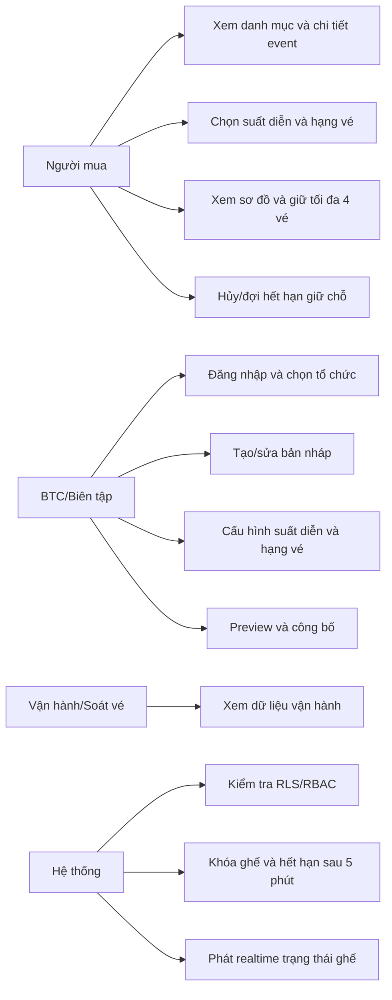
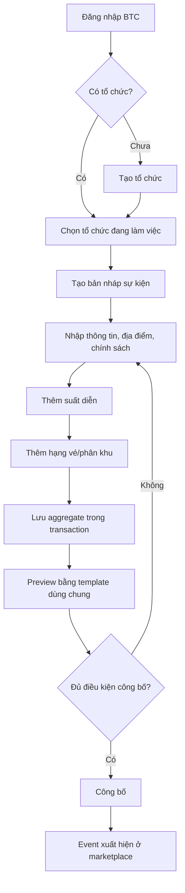
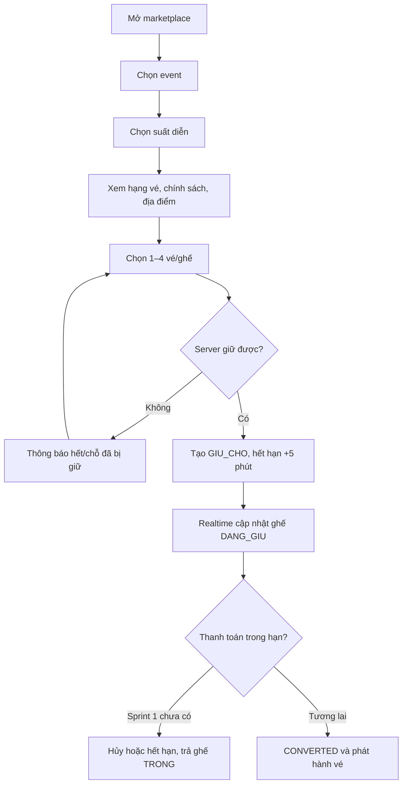
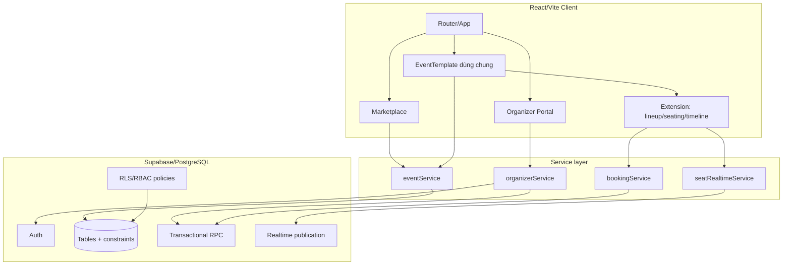
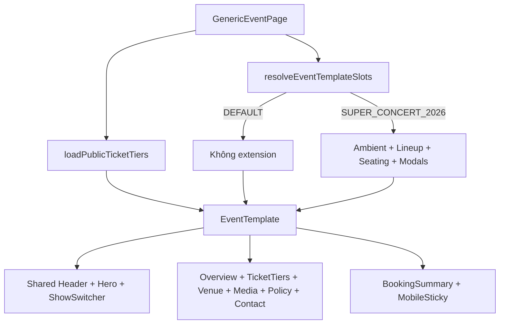

# 02 — Phân tích và thiết kế hệ thống

## 1. Use case tổng quan



## 2. Activity — luồng BTC tạo và công bố event



## 3. Activity — luồng người mua



## 4. Kiến trúc logic



## 5. Sequence — giữ chỗ 5 phút và chống bán trùng

```mermaid
sequenceDiagram
  actor U as Người mua
  participant UI as React UI
  participant S as bookingService
  participant RPC as tao_giu_cho RPC
  participant DB as PostgreSQL
  participant WS as Realtime

  U->>UI: Chọn 1–4 vé/ghế
  UI->>S: createHold(items, sessionId)
  S->>RPC: eventId, showId, sessionId, items
  RPC->>DB: BEGIN; expire holds cũ
  RPC->>DB: SELECT zone/seat FOR UPDATE
  alt Ghế TRONG và đủ tồn
    RPC->>DB: INSERT GIU_CHO expiresAt = now + 5m
    RPC->>DB: UPDATE GHE = DANG_GIU
    RPC->>DB: INSERT CHI_TIET_GIU_CHO
    DB-->>WS: Phát thay đổi GHE
    RPC-->>S: holdId, expiresAt, ACTIVE
    S-->>UI: Hiển thị countdown
  else Không đủ tồn/đã bị giữ
    RPC-->>S: Lỗi nghiệp vụ
    S-->>UI: Yêu cầu chọn lại
  end
```

## 6. Thiết kế component chi tiết event



Điểm thiết kế chính: template quyết định **cấu trúc chuẩn**, còn specialization chỉ bổ sung nội dung. Vì vậy BTC tạo event mới không cần code riêng, trong khi Super Concert vẫn giữ trải nghiệm đặc thù.

