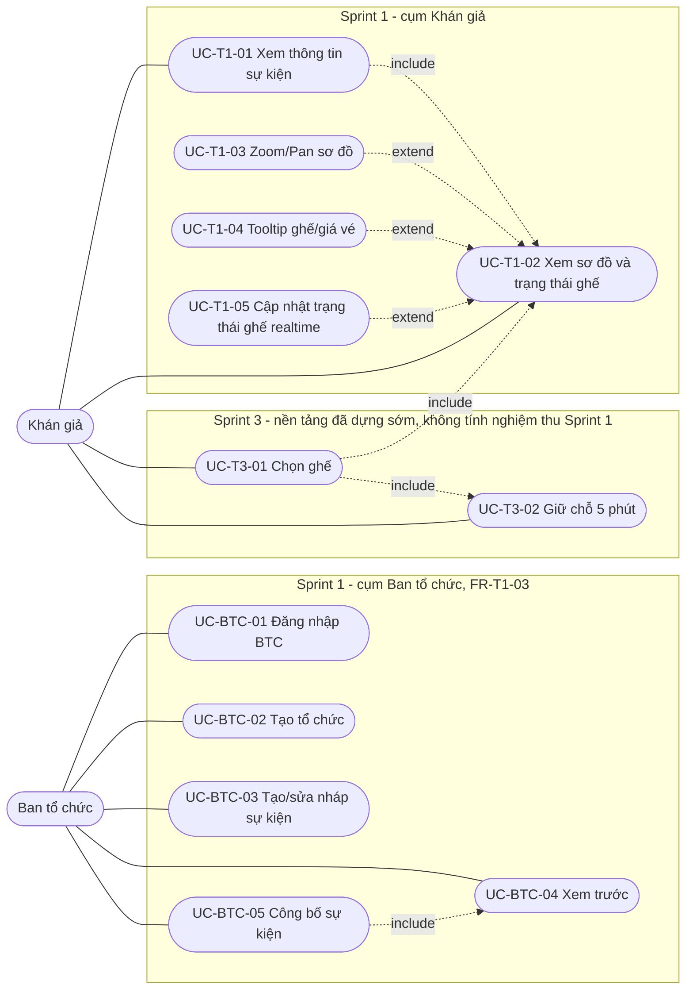
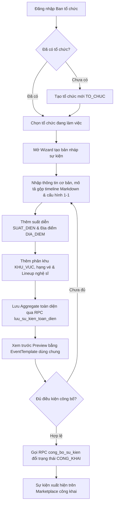
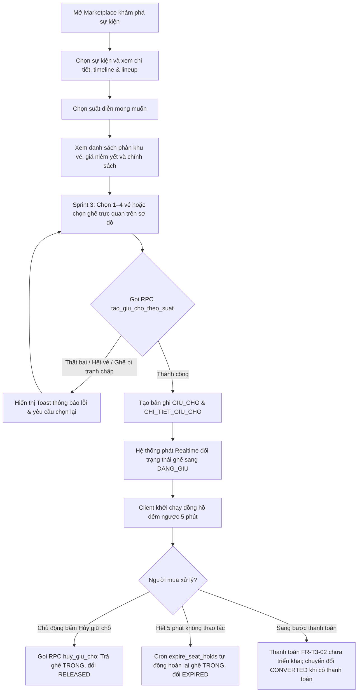
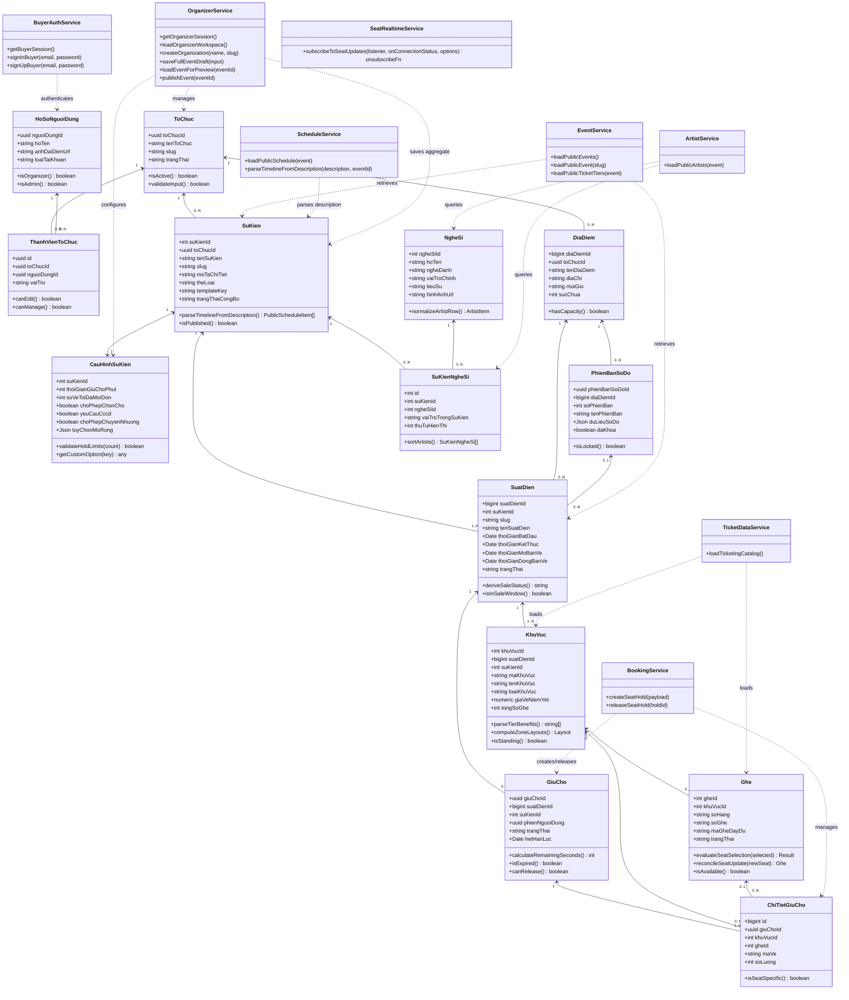
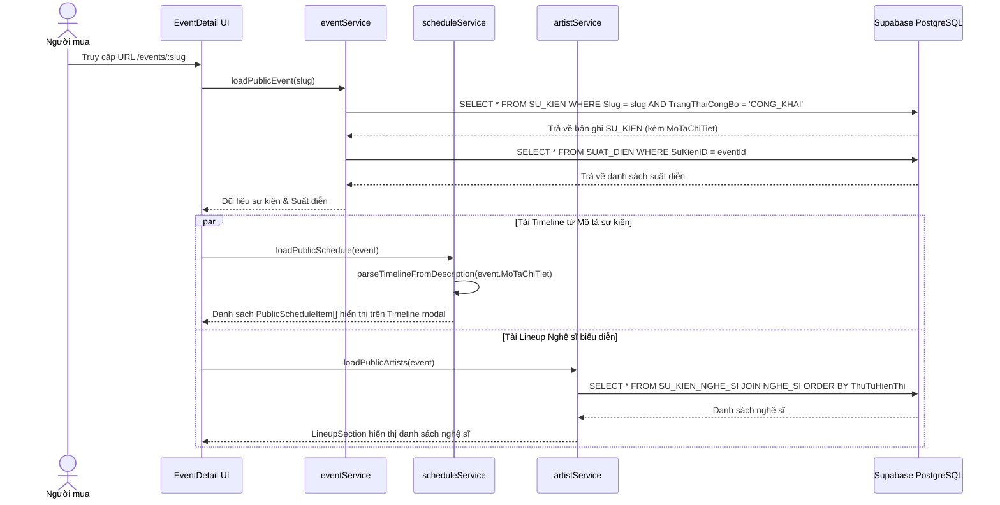
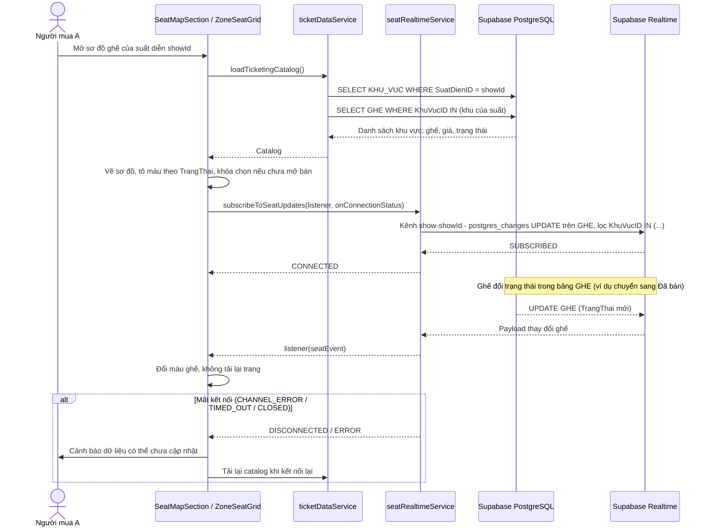
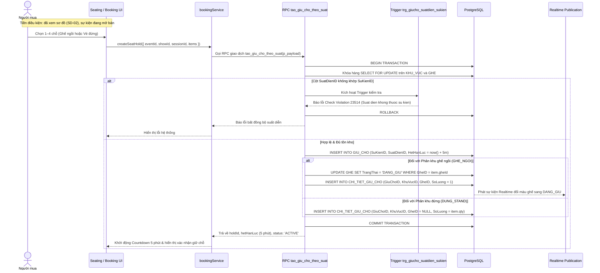
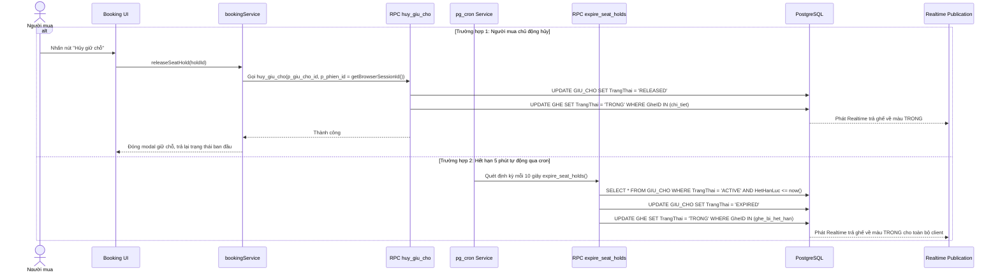
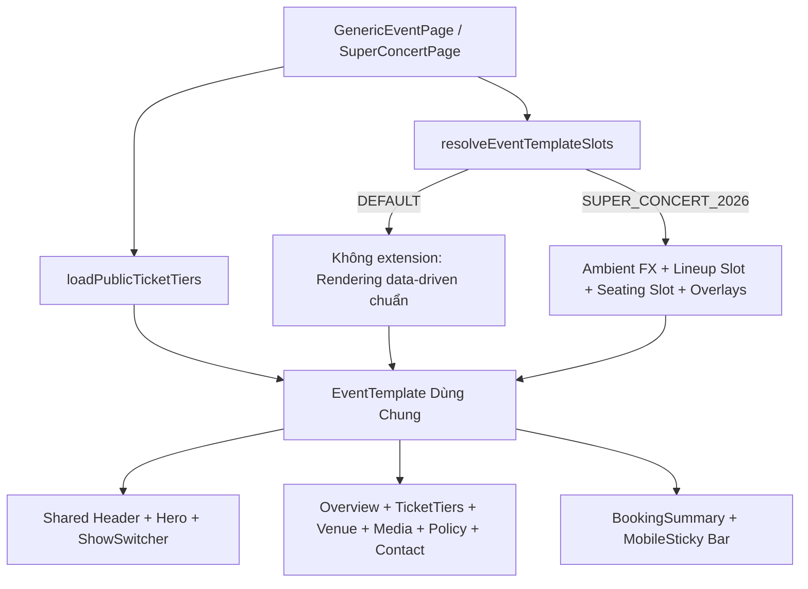

# 02 — Phân tích và thiết kế hệ thống

## 1. Use case tổng quan và danh mục Use Case

> **Quy ước mã thống nhất (02/11/2026).** Mã yêu cầu theo SRS: `FR-T1-01..04` (Sprint 1), `FR-T3-01` (Sprint 3). `FR-T1-03` (cổng Ban tổ chức) gồm `FR-T1-03.1..03.6`, trước đây ký hiệu `FR-O01..O06`. Mã Use Case theo tài liệu đặc tả `Requirements_UseCases_Sprint1`: `UC-T1-01..05`, `UC-BTC-01..05`, `UC-T3-01..02`. NFR dùng đúng số hiệu ở Phần 2 của SRS; các ràng buộc chất lượng nội bộ ghi là `QA-xx`.

Sơ đồ UML chuẩn (ranh giới hệ thống, «include»/«extend») là Hình 5.1 và Hình 5.5 trong tài liệu đặc tả `Requirements_UseCases_Sprint1`. Sơ đồ dưới đây là bản tóm tắt để đối chiếu với thiết kế; nét đứt là quan hệ «include»/«extend».



### Bảng danh mục Use Case chuẩn hóa

| Mã UC | Tên Use Case | Actor | FR | Sprint | Dữ liệu và nghiệp vụ cốt lõi | Mã cũ |
|---|---|---|---|:---:|---|---|
| **UC-T1-01** | Xem thông tin sự kiện (suất diễn, timeline, lineup, trạng thái mở bán) | Khán giả | FR-T1-01 | 1 | `SU_KIEN`, `SUAT_DIEN`; timeline bóc từ `MoTaChiTiet` **[Chú thích 3]**; lineup `SU_KIEN_NGHE_SI` + `NGHE_SI`; trạng thái mở bán `deriveSaleStatus` | UC-01, UC-02 |
| **UC-T1-02** | Xem sơ đồ khu vực/ghế, bảng giá và trạng thái ghế | Khán giả | FR-T1-02 | 1 | `KHU_VUC`, `GHE` theo `SuatDienID` qua `loadTicketingCatalog` | UC-02, UC-03 (phần xem) |
| **UC-T1-03** | Zoom/Pan sơ đồ | Khán giả | FR-T1-04 | 1 | Xử lý trên giao diện bằng dữ liệu đã tải | — |
| **UC-T1-04** | Tooltip ghế/giá vé, lọc khu, tìm ghế | Khán giả | FR-T1-04 | 1 | Xử lý trên giao diện bằng dữ liệu đã tải | — |
| **UC-T1-05** | Cập nhật trạng thái ghế realtime | Khán giả | FR-T1-02 | 1 | Supabase Realtime trên `GHE`, lọc theo `KhuVucID` của suất diễn | UC-03 (phần realtime) |
| **UC-BTC-01** | Đăng nhập BTC, phân loại tài khoản | BTC | FR-T1-03.1 | 1 | Supabase Auth; `HO_SO_NGUOI_DUNG.LoaiTaiKhoan` | UC-05 |
| **UC-BTC-02** | Tạo tổ chức, phân quyền thành viên (vai trò `VAN_HANH`, `SOAT_VE` chỉ xem) | BTC | FR-T1-03.2 | 1 | RPC `tao_to_chuc_cua_toi`; `TO_CHUC`, `THANH_VIEN_TO_CHUC`; `la_thanh_vien_to_chuc` | UC-05, UC-09 |
| **UC-BTC-03** | Tạo/sửa nháp sự kiện (suất diễn, phân khu/hạng vé, timeline, nghệ sĩ) | BTC | FR-T1-03.3 | 1 | RPC `luu_su_kien_toan_dien`: `SU_KIEN`, `CAU_HINH_SU_KIEN`, `SUAT_DIEN`, `KHU_VUC`, `SU_KIEN_NGHE_SI`, `NGHE_SI` (chưa sinh `GHE`) | UC-06, UC-07 |
| **UC-BTC-04** | Xem trước bản nháp | BTC | FR-T1-03.4 | 1 | `loadEventForPreview`; trang sự kiện với `?preview=1` | UC-08 |
| **UC-BTC-05** | Công bố sự kiện | BTC | FR-T1-03.5 | 1 | `evaluatePublishReadiness` (client) + RPC `cong_bo_su_kien` | UC-08 |
| **UC-T3-01** | Chọn ghế (tối đa 4) | Khán giả | FR-T3-01 | 3 | `evaluateSeatSelection` | UC-03 (phần chọn) |
| **UC-T3-02** | Giữ chỗ 5 phút, hủy, hết hạn | Khán giả | FR-T3-01 | 3 | RPC `tao_giu_cho_theo_suat`, `huy_giu_cho`, `expire_seat_holds` (pg_cron); `GIU_CHO`, `CHI_TIET_GIU_CHO` | UC-03 (phần giữ), UC-04 |

`FR-T1-03.6` (mọi sự kiện dùng chung template) là ràng buộc thiết kế của UC-T1-01, xem mục 7 và `04_UI_CONSISTENCY_ADR.md`.

## 2. Activity — Luồng Ban tổ chức tạo và công bố sự kiện



---

## 3. Activity — Luồng Người mua xem vé (Sprint 1) và giữ chỗ (Sprint 3)



Nghiệm thu Sprint 1 dừng ở bước D (xem sự kiện, suất diễn, hạng vé và sơ đồ ghế). Từ bước E trở đi là FR-T3-01 (Sprint 3); repo đã có lát cắt kỹ thuật nhưng không tính nghiệm thu Sprint 1.

---

## 4. Kiến trúc logic 3 lớp (Logical Architecture)

```mermaid
flowchart TB
  subgraph ClientLayer[Tầng Trình bày (React 19 / Vite Client)]
    R[App Router]
    MP[Marketplace / Catalog View]
    EP[EventTemplate dùng chung đa sự kiện]
    EX[Extension Slots: Lineup / Seating Map / Timeline Dialog]
    OP[Organizer Portal & Event Creation Wizard]
    RO[React Runtime Overlays: Tooltip / Toast / Hold Modal]
    R --> MP
    R --> EP
    EP --> EX
    EP --> RO
    R --> OP
  end

  subgraph ServiceLayer[Tầng Dịch vụ & Domain Logic (src/services & src/domain)]
    BAS[BuyerAuthService: Đăng nhập & Session người mua]
    OS[OrganizerService: Quản trị tổ chức & Lưu Aggregate sự kiện]
    ES[EventService: Truy vấn danh mục sự kiện & Suất diễn]
    SS[ScheduleService: Bóc tách Timeline từ Description]
    AS[ArtistService: Chuẩn hóa & Sắp xếp Lineup nghệ sĩ]
    TDS[TicketDataService: Truy vấn phân khu & hạng vé]
    BS[BookingService: Điều phối Giữ chỗ & Khóa ghế 5 phút]
    SRS[SeatRealtimeService: WebSocket quản lý trạng thái ghế]
  end

  subgraph SupabaseLayer[Tầng Dữ liệu & Nền tảng Cloud (Supabase / PostgreSQL 15+)]
    AUTH[Supabase Auth: Quản lý danh tính auth.users]
    DB[(14 Bảng CSDL Schema public + Ràng buộc toàn vẹn)]
    RPC[Hàm giao dịch Transactional RPC: SECURITY DEFINER]
    RLS[Hệ thống chính sách bảo mật dòng Row Level Security]
    WS[Kênh phát Realtime Publications: GHE, KHU_VUC]
    CRON[pg_cron: Tác vụ tự động quét hết hạn hold mỗi 10 giây]
  end

  MP --> ES
  EP --> ES
  EP --> SS
  EP --> AS
  EP --> TDS
  OP --> OS
  OP --> BAS
  EX --> BS
  EX --> SRS
  RO --> BS

  ES --> DB
  SS --> DB
  AS --> DB
  TDS --> DB
  OS --> RPC
  OS --> DB
  BAS --> AUTH
  BS --> RPC
  SRS --> WS
  RLS --> DB
  CRON --> RPC
```

---

## 5. Thiết kế hướng đối tượng — Class Diagram từ Repository

Sơ đồ lớp được trích xuất trực tiếp từ cấu trúc mã nguồn dự án (`src/domain/` và `src/services/`). **Đảm bảo mỗi bảng trong số 14 bảng ERD đều có đúng một lớp Entity tương ứng**, kết hợp với các lớp Service chịu trách nhiệm điều phối nghiệp vụ:



> **Chú thích về Class Diagram.** (1) Repo viết dạng module hàm (`createSeatHold`, `loadPublicEvent`...), không có `class BookingService`; mỗi *lớp Service* trong sơ đồ gom các hàm export của cùng một file `src/services/*.ts`, tên phương thức Service là tên hàm thật. (2) `GiuCho`, `ChiTietGiuCho` và `BookingService` phục vụ UC-T3-02 (Sprint 3, đã dựng sớm), không tính nghiệm thu Sprint 1. (3) Phương thức của *lớp Entity* (ví dụ `isExpired()`, `canRelease()`, `isLocked()`, `validateHoldLimits()`) là **hành vi nghiệp vụ được mô hình hóa** theo quy tắc trong SRS/RPC, không nhất thiết có hàm trùng tên trong mã nguồn; logic tương ứng nằm ở `src/domain/*` hoặc trong RPC của PostgreSQL.

### Bảng đối chiếu 14 Bảng ERD ↔ 14 Lớp Entity ↔ Lớp Service & File nguồn

| Bảng CSDL | Lớp Entity | Lớp Service xử lý chính | File nguồn trong Repo | Vai trò và hành vi chính |
|---|---|---|---|---|
| `TO_CHUC` | `ToChuc` | `OrganizerService` | `src/services/organizerService.ts` | Quản lý định danh tổ chức, workspace của ban tổ chức. |
| `HO_SO_NGUOI_DUNG` | `HoSoNguoiDung` | `BuyerAuthService`, `OrganizerService` | `src/services/buyerAuthService.ts` | Hồ sơ người dùng, phân loại tài khoản `USER` / `ORGANIZER`. |
| `THANH_VIEN_TO_CHUC` | `ThanhVienToChuc` | `OrganizerService` | `src/services/organizerService.ts` | Phân quyền RBAC đa cấp độ cho thành viên tổ chức. |
| `SU_KIEN` | `SuKien` | `EventService`, `OrganizerService` | `src/services/eventService.ts` | Quản lý sự kiện, bóc tách timeline qua `parseTimelineFromDescription`. |
| `CAU_HINH_SU_KIEN` | `CauHinhSuKien` | `OrganizerService` | `src/services/organizerService.ts` | Cấu hình 1–1 (thời gian giữ chỗ, tối đa 4 vé, tùy chọn mở rộng). |
| `DIA_DIEM` | `DiaDiem` | `EventService`, `OrganizerService` | `src/services/eventService.ts` | Danh mục địa điểm, địa chỉ và sức chứa. |
| `PHIEN_BAN_SO_DO` | `PhienBanSoDo` | `TicketDataService` | `src/services/ticketDataService.ts` | Phiên bản sơ đồ ghế ngồi của địa điểm. |
| `SUAT_DIEN` | `SuatDien` | `EventService`, `OrganizerService` | `src/domain/eventStatus.js` | Suất diễn, tính toán trạng thái mở bán `deriveSaleStatus`. |
| `KHU_VUC` | `KhuVuc` | `TicketDataService`, `OrganizerService` | `src/domain/seatMap.js` | Phân khu vé, tính giá tiền, bóc tách quyền lợi `parseTierBenefits`. |
| `GHE` | `Ghe` | `TicketDataService`, `SeatRealtimeService` | `src/domain/seatMap.js` | Ghế ngồi vật lý, kiểm tra hợp lệ chọn ghế `evaluateSeatSelection`. |
| `GIU_CHO` | `GiuCho` | `BookingService` | `src/services/bookingService.ts` | Header giữ chỗ 5 phút, đếm ngược `calculateRemainingSeconds`. |
| `CHI_TIET_GIU_CHO` | `ChiTietGiuCho` | `BookingService` | `src/services/bookingService.ts` | Dòng giữ chỗ chi tiết (phân biệt khu đứng và ghế ngồi). |
| `NGHE_SI` | `NgheSi` | `ArtistService`, `OrganizerService` | `src/domain/artistLineup.js` | Danh mục nghệ sĩ, chuẩn hóa dữ liệu `normalizeArtistRow`. |
| `SU_KIEN_NGHE_SI` | `SuKienNgheSi` | `ArtistService`, `OrganizerService` | `src/services/artistService.ts` | Liên kết Lineup nghệ sĩ, sắp xếp thứ tự diễn `sortArtists`. |

---

## 6. Sequence Diagrams (`SD-01` .. `SD-06`)

Sprint 1: SD-01 đến SD-04. Sprint 3 (nền tảng đã dựng sớm): SD-05, SD-06. Bản phân tích mức nghiệp vụ (lớp Boundary/Control/Entity) nằm ở Hình 5.3–5.8 của tài liệu đặc tả; các sơ đồ dưới đây là mức thiết kế, dùng đúng tên hàm và RPC trong mã nguồn.

### SD-01: Người mua xem danh mục, chi tiết sự kiện, suất diễn, lineup và timeline (UC-T1-01, Sprint 1)




---

### SD-02: Xem sơ đồ ghế và cập nhật trạng thái realtime (UC-T1-02, UC-T1-05, Sprint 1)

Luồng Sprint 1 chỉ đọc: tải danh mục khu vực/ghế của suất diễn, vẽ sơ đồ, rồi nhận thay đổi trạng thái ghế qua Supabase Realtime (US-T1-01 Scenario 2, ví dụ ghế chuyển sang Đã bán). Sơ đồ chỉ hiển thị thay đổi; trong repo hiện tại, thay đổi trên `GHE` phát sinh từ lát cắt giữ chỗ UC-T3-02 (Sprint 3).



---

### SD-03: Đăng nhập BTC, phân loại tài khoản, tạo tổ chức và phân quyền (UC-BTC-01, UC-BTC-02, Sprint 1)

```mermaid
sequenceDiagram
  actor O as Ban tổ chức
  participant UI as Organizer Portal
  participant OS as organizerService
  participant AUTH as Supabase Auth
  participant DB as PostgreSQL

  O->>UI: Nhập email và mật khẩu
  UI->>OS: signInOrganizer(email, password)
  OS->>AUTH: auth.signInWithPassword()
  AUTH-->>OS: Session (auth.uid)
  UI->>OS: getOrganizerSession()
  OS->>DB: SELECT LoaiTaiKhoan FROM HO_SO_NGUOI_DUNG WHERE NguoiDungID = auth.uid()
  DB-->>OS: LoaiTaiKhoan
  OS-->>UI: session.accountKind
  alt accountKind không phải ORGANIZER (tài khoản người mua)
    UI->>O: Từ chối vào cổng BTC (isOrganizerAccount = false)
  else Tài khoản BTC
    UI->>OS: loadOrganizerWorkspace()
    OS->>DB: SELECT TO_CHUC, SU_KIEN của tổ chức (RLS: la_thanh_vien_to_chuc)
    DB-->>OS: Workspace
    opt Chưa thuộc tổ chức nào (UC-BTC-02)
      O->>UI: Nhập tên tổ chức và slug
      UI->>OS: createOrganization(name, slug)
      OS->>DB: RPC tao_to_chuc_cua_toi(p_ten_to_chuc, p_slug)
      DB->>DB: INSERT TO_CHUC + INSERT THANH_VIEN_TO_CHUC (VaiTro = CHU_SO_HUU)
      DB-->>OS: ToChucID
    end
    OS-->>UI: Hiển thị workspace; vai trò VAN_HANH/SOAT_VE chỉ xem, thao tác ghi bị RLS chặn
  end
```

---

### SD-04: BTC tạo/lưu sự kiện, xem trước và công bố (UC-BTC-03, UC-BTC-04, UC-BTC-05, Sprint 1)


```mermaid
sequenceDiagram
  actor O as Ban tổ chức
  participant UI as Organizer Event Wizard
  participant OS as organizerService
  participant RPC_SAVE as RPC luu_su_kien_toan_dien
  participant RPC_PUB as RPC cong_bo_su_kien
  participant DB as PostgreSQL

  O->>UI: Nhập thông tin sự kiện, timeline Markdown, cấu hình 1-1, suất diễn, hạng vé & nghệ sĩ
  UI->>OS: saveFullEventDraft(payload)
  OS->>RPC_SAVE: luu_su_kien_toan_dien(p_payload JSONB)
  RPC_SAVE->>DB: Kiểm tra quyền co_quyen_bien_tap_to_chuc(orgId)
  RPC_SAVE->>DB: INSERT / UPDATE SU_KIEN (lưu MoTaChiTiet gộp timeline)
  RPC_SAVE->>DB: INSERT / UPDATE CAU_HINH_SU_KIEN (quan hệ 1-1 SuKienID, TuyChonMoRong)
  RPC_SAVE->>DB: Đồng bộ SUAT_DIEN và KHU_VUC/hạng vé (kèm trigger kiểm tra SuKienID; chưa sinh GHE)
  RPC_SAVE->>DB: Đồng bộ SU_KIEN_NGHE_SI và master catalog NGHE_SI
  DB-->>RPC_SAVE: Thành công
  RPC_SAVE-->>OS: Trả về eventId, slug, status: 'BAN_NHAP'
  OS-->>UI: Lưu bản nháp thành công

  O->>UI: Nhấn nút "Xem trước (Preview)"
  UI->>OS: loadEventForPreview(eventId)
  UI->>UI: Mở trang xem trước (?preview=1) với EventTemplate chuẩn dùng chung

  O->>UI: Nhấn "Công bố sự kiện"
  UI->>UI: evaluatePublishReadiness(form) - chặn nếu còn tiêu chí chưa đạt
  UI->>OS: publishEvent(eventId)
  OS->>RPC_PUB: cong_bo_su_kien(eventId)
  RPC_PUB->>DB: Kiểm tra điều kiện (có >=1 suất diễn, >=1 phân khu vé)
  RPC_PUB->>DB: UPDATE SU_KIEN SET TrangThaiCongBo = 'CONG_KHAI'
  DB-->>RPC_PUB: Cập nhật thành công
  RPC_PUB-->>OS: Sự kiện đã công bố
  OS-->>UI: Chuyển trạng thái sang CONG_KHAI, xuất hiện trên Marketplace
```

---

### SD-05: Giữ chỗ 5 phút chống bán trùng (UC-T3-02, Sprint 3)


Sprint 3 (FR-T3-01) – lát cắt kỹ thuật đã dựng sớm, không tính nghiệm thu Sprint 1. Biểu diễn luồng chọn vé với hai trường hợp: **khu ghế ngồi** (`GheID` cụ thể) và **khu vé đứng** (`GheID = NULL`), đồng thời thể hiện cơ chế kiểm tra trigger giữa `SuatDienID` và `SuKienID`:



---

### SD-06: Hủy giữ chỗ chủ động và hết hạn tự động qua pg_cron (UC-T3-02 luồng A2/A3, Sprint 3)




---

## 7. Thiết kế component chi tiết event (EventTemplate Architecture)



Điểm thiết kế chính: Template quyết định **cấu trúc chuẩn và trải nghiệm người dùng thống nhất**, các phần đặc thù của từng thể loại sự kiện (như sơ đồ ghế tương tác, lineup nghệ sĩ biểu diễn) được cắm vào qua cơ chế **Extension Slots**, đảm bảo không nhân bản trang hay hard-code mã nguồn.
