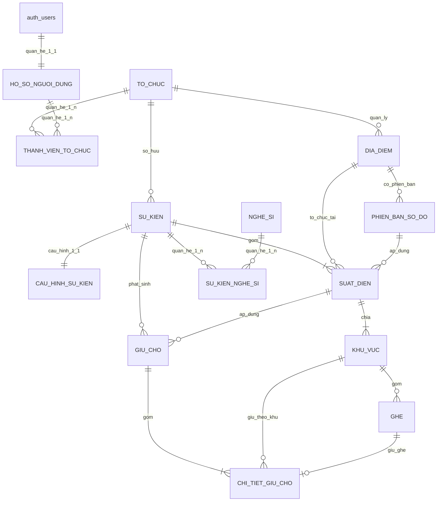
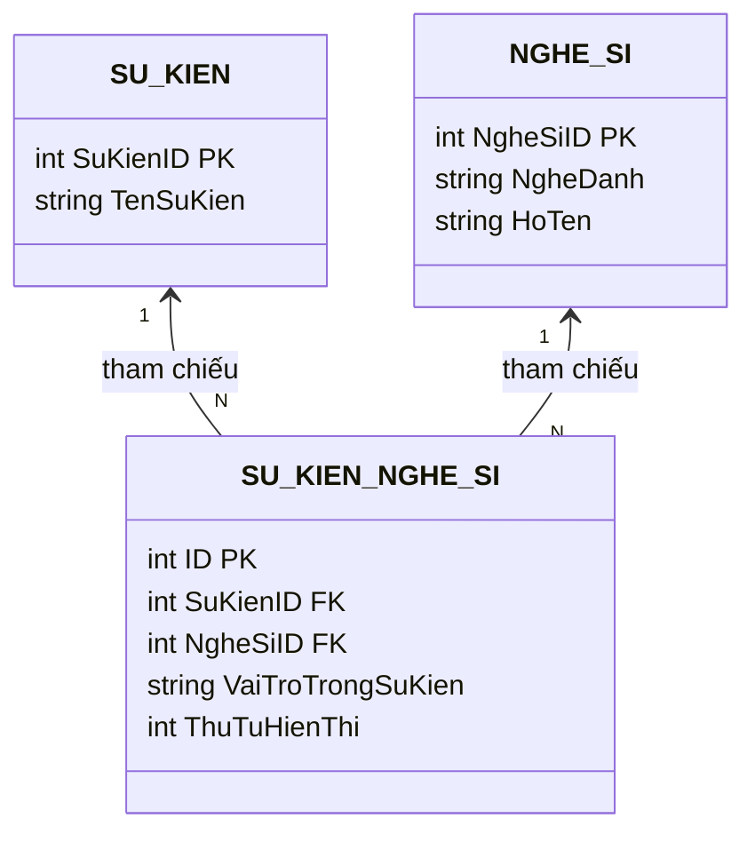

# 03 — Thiết kế cơ sở dữ liệu

## 1. Sơ đồ thực thể - mối quan hệ (ERD)

---

## 2. Phân loại và chứng minh 3 mối quan hệ trong CSDL

Hệ thống cơ sở dữ liệu EventTicketing thể hiện rõ ràng và đầy đủ cả 3 loại quan hệ cơ bản trong mô hình dữ liệu quan hệ (RDBMS):

### 2.1. Mối quan hệ Một - Một (1 - 1 / One-to-One)

| Mối quan hệ | Thực thể A | Thực thể B | Ràng buộc khóa & Kỹ thuật cài đặt |
|---|---|---|---|
| **Cấu hình sự kiện** | `SU_KIEN` | `CAU_HINH_SU_KIEN` | `CAU_HINH_SU_KIEN.SuKienID` vừa là **Primary Key** vừa là **Foreign Key** (`REFERENCES SU_KIEN(SuKienID) ON DELETE CASCADE`). Mỗi sự kiện có đúng duy nhất 1 bản ghi cấu hình, loại bỏ nguy cơ trùng lặp hoặc mồ côi dữ liệu. |
| **Hồ sơ tài khoản** | `auth.users` | `HO_SO_NGUOI_DUNG` | `HO_SO_NGUOI_DUNG.NguoiDungID` là **Primary Key** đồng thời là **Foreign Key** tham chiếu `auth.users(id) ON DELETE CASCADE`. |

> **Giải thích kiến trúc Hybrid của `CAU_HINH_SU_KIEN`**:
> - Nhằm phục vụ tính đa dạng của các sự kiện (Concert, Workshop, Giải đấu Thể thao, Hội thảo), bảng `CAU_HINH_SU_KIEN` kết hợp giữa:
>   1. **Cột cố định quan hệ**: `ThoiGianGiuChoPhut`, `SoVeToiDaMoiDon`, `ChoPhepChonCho`, `YeuCauCCCD`, `ChoPhepChuyenNhuong` (phục vụ lọc, index, ràng buộc CHECK và transactional processing).
>   2. **Cột mở rộng phi cấu trúc**: `TuyChonMoRong JSONB` (lưu các thuộc tính nghiệp vụ riêng biệt như `soundcheck_vip`, `zoom_link`, `quy_dinh_dong_phuc`, `do_tuoi_toi_thieu`) mà không làm phình hay phân mảnh schema quan hệ.

---

### 2.2. Mối quan hệ Một - Nhiều (1 - N / One-to-Many)

Quan hệ cha - con phân cấp tự nhiên trong mô hình đặt vé:

| Thực thể Một (1) | Thực thể Nhiều (N) | Khóa ngoại | Ý nghĩa nghiệp vụ |
|---|---|---|---|
| `TO_CHUC` | `SU_KIEN` | `SU_KIEN.ToChucID` | Một tổ chức / Ban tổ chức có thể tạo và quản lý nhiều sự kiện. |
| `SU_KIEN` | `SUAT_DIEN` | `SUAT_DIEN.SuKienID` | Một sự kiện có thể bao gồm một hoặc nhiều suất diễn (Multi-show). |
| `SUAT_DIEN` | `KHU_VUC` | `KHU_VUC.SuatDienID` | Mỗi suất diễn được phân chia thành nhiều hạng vé / khán đài với mức giá riêng. |
| `KHU_VUC` | `GHE` | `GHE.KhuVucID` | Mỗi phân khu có nhiều vị trí ghế ngồi cụ thể hoặc vé đứng. |
| `GIU_CHO` | `CHI_TIET_GIU_CHO` | `CHI_TIET_GIU_CHO.GiuChoID` | Một phiên giữ chỗ của khán giả có thể chứa từ 1 đến 4 vé/ghế. |

---

### 2.3. Mối quan hệ Nhiều - Nhiều (N - N / Many-to-Many)

Được chuẩn hóa chuẩn 3NF thông qua các bảng nối (Junction/Associative Tables):

| Mối quan hệ N-N | Thực thể 1 | Thực thể 2 | Bảng trung gian (Junction Table) | Thuộc tính quan hệ |
|---|---|---|---|---|
| **Sự kiện & Lineup nghệ sĩ** | `SU_KIEN` | `NGHE_SI` | `SU_KIEN_NGHE_SI` | `VaiTroTrongSuKien`, `ThuTuHienThi`, Unique `(SuKienID, NgheSiID)` |
| **Hồ sơ & Thành viên tổ chức** | `HO_SO_NGUOI_DUNG` | `TO_CHUC` | `THANH_VIEN_TO_CHUC` | `VaiTro` (ADMIN, ORGANIZER, STAFF), Unique `(ToChucID, NguoiDungID)` |

- **Ý nghĩa nghiệp vụ Sự kiện & Nghệ sĩ**: Một sự kiện (như Super Concert) có nhiều ca sĩ, DJ, ban nhạc tham gia. Ngược lại, một nghệ sĩ nổi tiếng (Sơn Tùng M-TP, Soobin) có thể biểu diễn tại nhiều sự kiện khác nhau của hệ thống mà không phải nhân bản hồ sơ nghệ sĩ.
- **Ý nghĩa nghiệp vụ Người dùng & Tổ chức**: Một cá nhân có thể thuộc về nhiều đơn vị tổ chức sự kiện khác nhau; một tổ chức có nhiều thành viên cùng quản lý.

---

## 3. Kiến trúc Timeline không cần bảng riêng

- **Yêu cầu thực tế**: Theo tinh thần đơn giản hóa và tối ưu hóa hệ thống, timeline sự kiện không yêu cầu một bảng cơ sở dữ liệu riêng biệt (`LICH_TRINH` đã được loại bỏ).
- **Cơ chế lưu trữ**: Toàn bộ lịch trình, mốc thời gian và hướng dẫn tham gia được lưu trữ trực tiếp trong trường **`MoTaChiTiet` (TEXT/Markdown)** của bảng `SU_KIEN`.
- **Cơ chế hiển thị**:
  1. Frontend sử dụng hàm chuẩn hóa `parseTimelineFromDescription` để tự động bóc tách các mốc thời gian dạng Markdown (ví dụ: `- **16:30 - 18:30**: Mở cổng check-in`) thành các đối tượng `PublicScheduleItem` hiển thị trên modal Timeline.
  2. Trường hợp sự kiện chỉ có văn bản mô tả thông thường, modal Timeline tự động hiển thị nội dung `MoTaChiTiet` một cách trang nhã, không phụ thuộc vào bảng rời.

---

## 4. Data dictionary cốt lõi

| Bảng | Khóa chính | Vai trò | Ràng buộc đáng chú ý |
|---|---|---|---|
| `TO_CHUC` | `ToChucID` UUID | Tenant/BTC | `Slug` unique, trạng thái hoạt động/tạm khóa |
| `HO_SO_NGUOI_DUNG` | `NguoiDungID` UUID | Hồ sơ gắn Auth (1-1 `auth.users`) | Cascade khi xóa auth user |
| `THANH_VIEN_TO_CHUC` | `ID` UUID | Junction N-N giữa User và Tổ chức | Unique `(ToChucID, NguoiDungID)`; role enum |
| `SU_KIEN` | `SuKienID` serial | Aggregate sự kiện (chứa `MoTaChiTiet`) | Thuộc `ToChucID`; `Slug` unique; trạng thái công bố |
| `CAU_HINH_SU_KIEN` | `SuKienID` int | Cấu hình nghiệp vụ (1-1 với `SU_KIEN`) | PK đồng thời là FK `SU_KIEN`; cột `TuyChonMoRong JSONB` |
| `SUAT_DIEN` | `SuatDienID` bigserial | Lần diễn/bán riêng (1-N từ Event) | Unique `(SuKienID, Slug)`; kiểm tra thời gian |
| `DIA_DIEM` | `DiaDiemID` bigserial | Địa điểm tái sử dụng | Thuộc tổ chức, sức chứa > 0 |
| `PHIEN_BAN_SO_DO` | UUID | Version sơ đồ | Unique `(DiaDiemID, SoPhienBan)`; có cờ khóa |
| `KHU_VUC` | `KhuVucID` serial | Hạng vé/phân khu (1-N từ Show) | Unique `(SuatDienID, MaKhuVuc)`; giá >= 0 |
| `GHE` | `GheID` serial | Ghế vật lý (1-N từ Zone) | Unique `(KhuVucID, MaGheDayDu)`; trạng thái realtime |
| `GIU_CHO` | `GiuChoID` UUID | Header giữ chỗ | Có session, show, `HetHanLuc`, status enum |
| `CHI_TIET_GIU_CHO` | `ID` bigserial | Vé/ghế trong hold (1-N từ Hold) | Số lượng 1–4; ghế nullable cho khu đứng |
| `NGHE_SI` | `NgheSiID` serial | Master catalog Nghệ sĩ | Master data dùng chung toàn hệ thống |
| `SU_KIEN_NGHE_SI` | `ID` serial | Junction N-N giữa Event và Nghệ sĩ | Unique `(SuKienID, NgheSiID)` |

---

## 5. Ràng buộc đảm bảo toàn vẹn

- Khóa ngoại theo chuỗi tổ chức → sự kiện → suất diễn → khu vực → ghế.
- Ràng buộc 1-1 chặt chẽ giữa `SU_KIEN` và `CAU_HINH_SU_KIEN` qua `PRIMARY KEY REFERENCES`.
- Trigger kiểm tra `KHU_VUC.SuatDienID` thật sự thuộc `SuKienID` trong giai đoạn tương thích.
- `tao_giu_cho` chạy trong transaction, khóa record bằng `FOR UPDATE`, kiểm tra tổng số lượng 1–4 và tồn khả dụng.
- Partial index trên giữ chỗ đang hoạt động/hết hạn và chi tiết ghế hỗ trợ truy vấn cạnh tranh.
- RLS phân quyền theo Role và Organization Membership.
