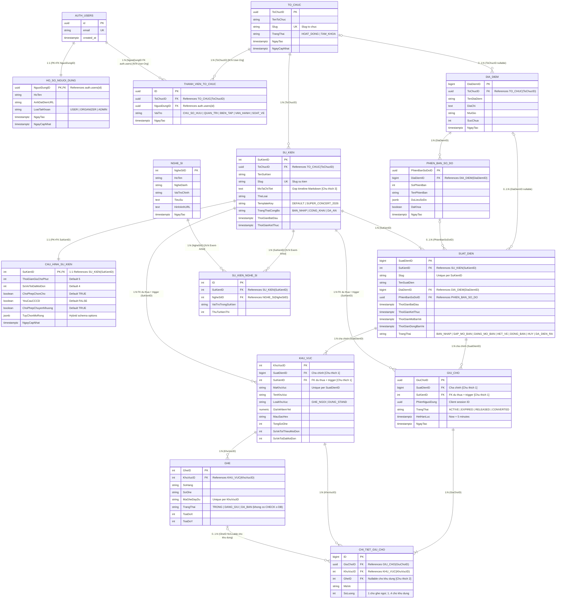
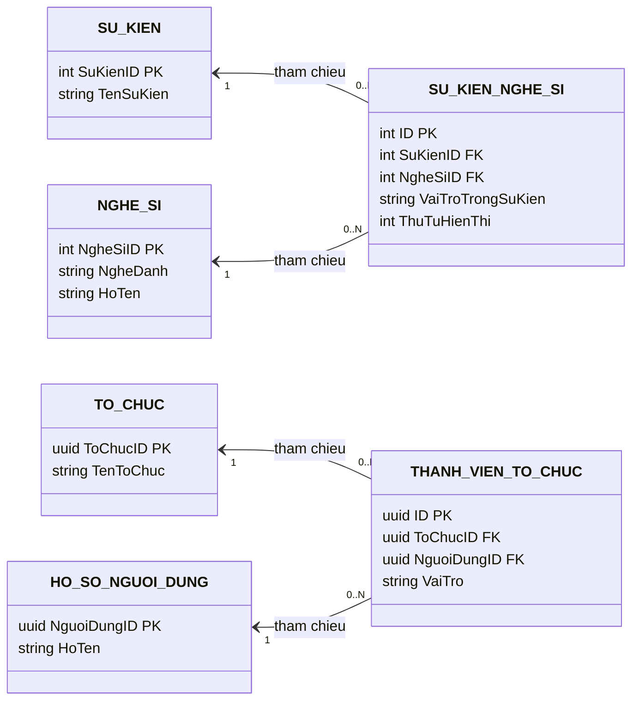

# 03 — Thiết kế cơ sở dữ liệu

## 1. Sơ đồ thực thể - mối quan hệ (ERD 14 bảng chuẩn)

Sơ đồ ERD bao gồm đầy đủ **14 bảng trong schema `public`** của hệ thống EventTicketing (cùng thực thể tích hợp `AUTH_USERS` đại diện cho `auth.users` của Supabase Auth), thể hiện rõ ràng các thuộc tính Khóa chính (`PK`), Khóa ngoại (`FK`), Ràng buộc duy nhất (`UK`), kiểu dữ liệu và ký hiệu bội số quan hệ (Crow's Foot notation).

---

## 2. Phân loại và chứng minh 3 loại mối quan hệ trong CSDL

Hệ thống cơ sở dữ liệu EventTicketing thể hiện rõ ràng, đầy đủ và chuẩn tắc cả 3 loại quan hệ cơ bản trong mô hình dữ liệu quan hệ (RDBMS). Báo cáo chính thức tuyên bố và chứng minh chi tiết như sau:

### 2.1. Mối quan hệ Một - Một (1 - 1 / One-to-One)

| Mối quan hệ | Thực thể A (1) | Thực thể B (1) | Bội số | Khóa & Kỹ thuật cài đặt ở tầng PostgreSQL DDL | Ý nghĩa nghiệp vụ |
|---|---|---|:---:|---|---|
| **Cấu hình sự kiện** | `SU_KIEN` | `CAU_HINH_SU_KIEN` | `1 : 1` | `CAU_HINH_SU_KIEN.SuKienID` vừa là **Primary Key** vừa là **Foreign Key** (`REFERENCES public."SU_KIEN"("SuKienID") ON DELETE CASCADE`). | Mỗi sự kiện có đúng duy nhất 1 bản ghi cấu hình nghiệp vụ riêng (thời gian giữ chỗ, giới hạn vé, cấu hình mở rộng JSONB), loại trừ hoàn toàn nguy cơ trùng lặp hoặc bản ghi mồ côi. |
| **Hồ sơ tài khoản** | `auth.users` | `HO_SO_NGUOI_DUNG` | `1 : 1` | `HO_SO_NGUOI_DUNG.NguoiDungID` vừa là **Primary Key** vừa là **Foreign Key** (`REFERENCES auth.users(id) ON DELETE CASCADE`). | Mỗi tài khoản định danh Supabase Auth tương ứng duy nhất với 1 hồ sơ người dùng (`USER`, `ORGANIZER`, `ADMIN`). |

> **Kiến trúc Hybrid của `CAU_HINH_SU_KIEN`**:
> - Bảng `CAU_HINH_SU_KIEN` giải quyết bài toán đa dạng loại hình sự kiện (Concert, Workshop, Thể thao, Hội thảo) bằng cách kết hợp:
>   1. **Các cột cố định**: `ThoiGianGiuChoPhut`, `SoVeToiDaMoiDon`, `ChoPhepChonCho`, `YeuCauCCCD`, `ChoPhepChuyenNhuong` phục vụ index, lọc và ràng buộc CHECK chặt chẽ.
>   2. **Cột mở rộng phi cấu trúc**: `TuyChonMoRong JSONB` lưu các trường tùy biến theo từng loại sự kiện (ví dụ: `soundcheck_vip`, `zoom_link`, `quy_dinh_lightstick`) mà không làm phình hay phân mảnh schema quan hệ.

---

### 2.2. Mối quan hệ Một - Nhiều (1 - N / One-to-Many)

Các quan hệ cha - con phân cấp tự nhiên trong chuỗi cung ứng vé sự kiện:

| Thực thể Một (1) | Thực thể Nhiều (N) | Bội số | Khóa ngoại (FK) | Ý nghĩa nghiệp vụ & Ràng buộc toàn vẹn |
|---|---|:---:|---|---|
| `TO_CHUC` | `SU_KIEN` | `1 : 0..N` | `SU_KIEN.ToChucID` | Một đơn vị tổ chức (Tenant/BTC) sở hữu và quản lý nhiều sự kiện khác nhau. |
| `TO_CHUC` | `DIA_DIEM` | `0..1 : 0..N` | `DIA_DIEM.ToChucID` (nullable, `ON DELETE SET NULL`) | Một tổ chức quản lý danh mục các địa điểm tổ chức (SVĐ, Trung tâm hội nghị). |
| `DIA_DIEM` | `PHIEN_BAN_SO_DO` | `1 : 0..N` | `PHIEN_BAN_SO_DO.DiaDiemID` | Một địa điểm có thể có nhiều phiên bản sơ đồ chỗ ngồi (`Unique(DiaDiemID, SoPhienBan)`). |
| `DIA_DIEM` | `SUAT_DIEN` | `0..1 : 0..N` | `SUAT_DIEN.DiaDiemID` (nullable) | Nhiều suất diễn có thể được tổ chức tại cùng một địa điểm. |
| `PHIEN_BAN_SO_DO` | `SUAT_DIEN` | `0..1 : 0..N` | `SUAT_DIEN.PhienBanSoDoID` | Một phiên bản sơ đồ được áp dụng cho một hoặc nhiều suất diễn. |
| `SU_KIEN` | `SUAT_DIEN` | `1 : 1..N` | `SUAT_DIEN.SuKienID` | Một sự kiện có ít nhất một hoặc nhiều suất diễn (Multi-show, `Unique(SuKienID, Slug)`). |
| `SUAT_DIEN` | `KHU_VUC` | `1 : 1..N` | `KHU_VUC.SuatDienID` | **Cha chính**: Mỗi suất diễn chia thành nhiều phân khu / hạng vé (`Unique(SuatDienID, MaKhuVuc)`). |
| `KHU_VUC` | `GHE` | `1 : 0..N` | `GHE.KhuVucID` | Mỗi phân khu ghế ngồi chứa nhiều vị trí ghế vật lý cụ thể (`Unique(KhuVucID, MaGheDayDu)`). |
| `SUAT_DIEN` | `GIU_CHO` | `1 : 0..N` | `GIU_CHO.SuatDienID` | **Cha chính**: Các giao dịch giữ chỗ phát sinh trên từng suất diễn cụ thể. |
| `GIU_CHO` | `CHI_TIET_GIU_CHO` | `1 : 1..N` | `CHI_TIET_GIU_CHO.GiuChoID` | Một phiên giữ chỗ chứa từ 1 đến 4 vé/ghế (`CASCADE` khi xóa phiên giữ chỗ). |
| `KHU_VUC` | `CHI_TIET_GIU_CHO` | `1 : 0..N` | `CHI_TIET_GIU_CHO.KhuVucID` | Mỗi dòng chi tiết giữ chỗ trỏ về phân khu/hạng vé tương ứng. |
| `GHE` | `CHI_TIET_GIU_CHO` | `0..1 : 0..N` | `CHI_TIET_GIU_CHO.GheID` | Vị trí ghế vật lý được gán vào chi tiết giữ chỗ (NULL đối với khu đứng). |

---

### 2.3. Mối quan hệ Nhiều - Nhiều (N - N / Many-to-Many)

Mối quan hệ Nhiều - Nhiều được chuẩn hóa triệt để ở dạng chuẩn 3NF thông qua hai bảng trung gian (Junction / Associative Tables):

| Mối quan hệ N-N | Thực thể A | Thực thể B | Bảng trung gian (Junction Table) | Khóa & Ràng buộc toàn vẹn | Ý nghĩa nghiệp vụ |
|---|---|---|---|---|---|
| **Sự kiện & Nghệ sĩ** | `SU_KIEN` | `NGHE_SI` | `SU_KIEN_NGHE_SI` | `SuKienID FK`, `NgheSiID FK`, `UNIQUE("SuKienID", "NgheSiID")` | Một sự kiện có nhiều nghệ sĩ biểu diễn (Lineup); một nghệ sĩ nổi tiếng có thể tham gia nhiều sự kiện khác nhau của hệ thống mà không phải nhân bản hồ sơ nghệ sĩ. |
| **Người dùng & Tổ chức** | `HO_SO_NGUOI_DUNG` | `TO_CHUC` | `THANH_VIEN_TO_CHUC` | `ToChucID FK`, `NguoiDungID FK`, `UNIQUE("ToChucID", "NguoiDungID")` | Một người dùng có thể là thành viên của nhiều Ban tổ chức; một Ban tổ chức có nhiều thành viên cùng quản lý theo vai trò RBAC (`CHU_SO_HUU`, `QUAN_TRI`, `BIEN_TAP`, `VAN_HANH`, `SOAT_VE`). |

---

## 3. Ba chú thích kỹ thuật trọng yếu trong ERD và Data Dictionary

> [!IMPORTANT]
> Đây là 3 chú thích kỹ thuật bắt buộc phải nắm vững khi báo cáo thiết kế hệ thống và kiểm tra code:

### [Chú thích 1]: `KHU_VUC.SuKienID` và `GIU_CHO.SuKienID` là FK dư thừa có kiểm soát, cha chính là `SuatDienID`
- **Thực trạng**: Cả hai bảng `KHU_VUC` và `GIU_CHO` đều tồn tại đồng thời hai cột khóa ngoại: `SuatDienID` và `SuKienID`.
- **Bản chất kiến trúc**:
  - `SuatDienID` là **cha chính trực tiếp** (Primary Hierarchical Parent): Mỗi phân khu và mỗi phiên giữ chỗ đều gắn liền với một suất diễn cụ thể.
  - `SuKienID` là **khóa ngoại dư thừa có chủ đích** (Denormalized Foreign Key) nhằm tối ưu hóa hiệu năng truy vấn cho client công khai, tránh phải join bảng `SUAT_DIEN` khi tải chi tiết sự kiện và duy trì tính tương thích ngược với các client cũ.
- **Cơ chế đảm bảo toàn vẹn dữ liệu**: Để ngăn ngừa bất đồng bộ (tránh tình trạng `SuatDienID` thuộc sự kiện A nhưng `SuKienID` lại trỏ về sự kiện B), cơ sở dữ liệu cài đặt trigger cưỡng chế ở mức database engine:
  - Hàm kiểm tra: `public.kiem_tra_suat_dien_thuoc_su_kien()`
  - Triggers kích hoạt:
    - `trg_khuvuc_suatdien_sukien` trên bảng `KHU_VUC` (`BEFORE INSERT OR UPDATE OF "SuatDienID", "SuKienID"`)
    - `trg_giucho_suatdien_sukien` trên bảng `GIU_CHO` (`BEFORE INSERT OR UPDATE OF "SuatDienID", "SuKienID"`)
  - Nếu `SuatDienID` không thuộc đúng `SuKienID`, transaction bị rollback ngay lập tức với mã lỗi PostgreSQL `23514` (Check Violation: *'Suat dien khong thuoc su kien da chon'*).

### [Chú thích 2]: `CHI_TIET_GIU_CHO.GheID` có thể NULL (Phân biệt khu đứng và khu ghế ngồi)
- **Thực trạng**: Cột `CHI_TIET_GIU_CHO.GheID` cho phép giá trị `NULL` (`INT NULL REFERENCES GHE(GheID)`).
- **Lý do nghiệp vụ**: Hệ thống phục vụ hai hình thức phân khu vé khác nhau:
  1. **Phân khu ghế ngồi (`LoaiKhuVuc = 'GHE_NGOI'`)**: Khán giả chọn từng ghế cụ thể trên sơ đồ (VD: Ghế `VIP-A-01`). Khi đó `CHI_TIET_GIU_CHO.GheID` phải **NOT NULL theo quy tắc của RPC `tao_giu_cho_theo_suat`** (DB không có CHECK ép buộc), `SoLuong = 1`, và trạng thái ghế trong bảng `GHE` chuyển sang `DANG_GIU`.
  2. **Phân khu vé đứng tự do (`LoaiKhuVuc = 'DUNG_STAND'`)**: Khán giả giữ theo số lượng vé (VD: 2 vé Fanzone đứng). Khi đó không có ghế vật lý tương ứng, `CHI_TIET_GIU_CHO.GheID` có giá trị **`NULL`**, và trường `CHI_TIET_GIU_CHO.SoLuong` ghi nhận số lượng vé được giữ (từ 1 đến 4 vé). Trữ lượng khả dụng được kiểm soát trừ dần vào sức chứa `KHU_VUC.TongSoGhe`.

### [Chú thích 3]: Timeline chương trình đã được gộp trực tiếp vào `SU_KIEN.MoTaChiTiet`
- **Thực trạng**: Bảng `LICH_TRINH` đã được **loại bỏ hoàn toàn** khỏi cơ sở dữ liệu (`DROP TABLE public."LICH_TRINH" CASCADE`).
- **Lý do kiến trúc**: Lịch trình sự kiện (Timeline) về bản chất là thông tin mô tả diễn biến chương trình dành cho khán giả, không có các quan hệ giao dịch hay khóa ngoại phụ thuộc phức tạp. Việc duy trì một bảng riêng làm tăng chi phí bảo trì và phân mảnh dữ liệu.
- **Giải pháp triển khai**:
  - Toàn bộ timeline, mốc thời gian và nội dung hoạt động được lưu trực tiếp dưới dạng Markdown trong trường `MoTaChiTiet` của bảng `SU_KIEN`.
  - Frontend sử dụng parser an toàn `parseTimelineFromDescription(description, eventId)` trong [`src/domain/publicSchedule.js`](../../src/domain/publicSchedule.js) để tự động trích xuất các mốc thời gian (VD: `- **16:30 - 18:30**: Mở cổng check-in`) thành danh sách `PublicScheduleItem[]` hiển thị trên modal Timeline. Trường hợp sự kiện không có format timeline, modal hiển thị nguyên văn mô tả sự kiện một cách trang nhã.

---

## 4. Kết quả kiểm chứng thực tế trên Supabase Live (Đủ 14 bảng `public`)

Dự án đã kiểm tra thực tế hệ thống live trên project Supabase `qxkgkbayxxaakkwtepss` (REST API `https://qxkgkbayxxaakkwtepss.supabase.co/rest/v1/`). Kết quả ghi nhận **chính xác 14 bảng `public`**, bảng cũ `LICH_TRINH` trả về HTTP 404 (`PGRST205`):

| STT | Tên bảng CSDL (`public`) | Trạng thái Live | RLS | Ghi chú & Chú thích thiết kế |
|:---:|:---|:---:|:---:|:---|
| 1 | `TO_CHUC` | `200 OK` | Bật | Bảng tenant đơn vị tổ chức |
| 2 | `HO_SO_NGUOI_DUNG` | `200 OK` | Bật | **1–1** với `auth.users`, chứa `LoaiTaiKhoan` |
| 3 | `THANH_VIEN_TO_CHUC` | `200 OK` | Bật | **N–N** User ↔ Tổ chức (`Unique(ToChucID, NguoiDungID)`) |
| 4 | `SU_KIEN` | `200 OK` | Bật | Aggregate sự kiện, chứa `MoTaChiTiet` **[Chú thích 3]** |
| 5 | `CAU_HINH_SU_KIEN` | `200 OK` | Bật | **1–1** với `SU_KIEN` (`SuKienID PK=FK`), cột `TuyChonMoRong JSONB` |
| 6 | `DIA_DIEM` | `200 OK` | Bật | Danh mục địa điểm tổ chức |
| 7 | `PHIEN_BAN_SO_DO` | `200 OK` | Bật | Phiên bản sơ đồ chỗ ngồi của địa điểm |
| 8 | `SUAT_DIEN` | `200 OK` | Bật | Suất diễn, **cha chính của Khu vực & Giữ chỗ [Chú thích 1]** |
| 9 | `KHU_VUC` | `200 OK` | Bật | Phân khu/hạng vé, có trigger kiểm tra `SuatDienID`/`SuKienID` **[Chú thích 1]** |
| 10 | `GHE` | `200 OK` | Bật | Ghế vật lý, quản lý trạng thái realtime |
| 11 | `GIU_CHO` | `200 OK` | Bật | Giữ chỗ 5 phút, có trigger kiểm tra `SuatDienID`/`SuKienID` **[Chú thích 1]** |
| 12 | `CHI_TIET_GIU_CHO` | `200 OK` | Bật | Dòng vé giữ chỗ; `GheID` có thể `NULL` cho khu đứng **[Chú thích 2]** |
| 13 | `NGHE_SI` | `200 OK` | Bật | Master catalog nghệ sĩ biểu diễn |
| 14 | `SU_KIEN_NGHE_SI` | `200 OK` | Bật | **N–N** Sự kiện ↔ Nghệ sĩ (`Unique(SuKienID, NgheSiID)`) |
| *—* | *`LICH_TRINH` (cũ)* | *`404 Not Found`* | *—* | *Đã xóa thành công; timeline chuyển vào `SU_KIEN.MoTaChiTiet` **[Chú thích 3]*** |

---

## 5. Data Dictionary cốt lõi (Chi tiết 14 bảng)

| Bảng CSDL | Khóa chính | Khóa ngoại | Vai trò nghiệp vụ | Ràng buộc đáng chú ý |
|---|---|---|---|---|
| `TO_CHUC` | `ToChucID` UUID | — | Đơn vị tổ chức sự kiện | `Slug` UNIQUE; `TrangThai IN ('HOAT_DONG', 'TAM_KHOA')` |
| `HO_SO_NGUOI_DUNG` | `NguoiDungID` UUID | `auth.users(id)` | Hồ sơ gắn Auth (**Quan hệ 1–1**) | `CASCADE` khi xóa user; `LoaiTaiKhoan IN ('USER', 'ORGANIZER', 'ADMIN')`; trigger chống tự nâng cấp |
| `THANH_VIEN_TO_CHUC` | `ID` UUID | `ToChucID`, `NguoiDungID` | Phân quyền RBAC (**Quan hệ N–N**) | `UNIQUE(ToChucID, NguoiDungID)`; `VaiTro` enum 5 cấp bậc |
| `SU_KIEN` | `SuKienID` INT (Serial) | `ToChucID` | Thông tin sự kiện tổng thể | `Slug` UNIQUE; `MoTaChiTiet` gộp timeline **[Chú thích 3]**; `TemplateKey`; `TrangThaiCongBo` |
| `CAU_HINH_SU_KIEN` | `SuKienID` INT | `SU_KIEN(SuKienID)` | Cấu hình nghiệp vụ (**Quan hệ 1–1**) | `PK = FK`; `ThoiGianGiuChoPhut (1-60)`; `SoVeToiDaMoiDon (1-20)`; `TuyChonMoRong JSONB` |
| `DIA_DIEM` | `DiaDiemID` BIGINT | `ToChucID` | Địa điểm tái sử dụng | `SucChua > 0`; `MuiGio` chuẩn IANA |
| `PHIEN_BAN_SO_DO` | `PhienBanSoDoID` UUID | `DiaDiemID` | Sơ đồ chỗ ngồi của địa điểm | `UNIQUE(DiaDiemID, SoPhienBan)`; `DuLieuSoDo JSONB`; cờ khóa `DaKhoa` |
| `SUAT_DIEN` | `SuatDienID` BIGINT | `SuKienID`, `DiaDiemID`, `PhienBanSoDoID` | Suất diễn / Lần bán vé (**Cha chính [1]**) | `UNIQUE(SuKienID, Slug)`; `ThoiGianKetThuc > ThoiGianBatDau`; `TrangThai` enum 7 giá trị |
| `KHU_VUC` | `KhuVucID` INT (Serial) | `SuatDienID` (Cha chính), `SuKienID` (Dư thừa) | Phân khu / Hạng vé | `UNIQUE(SuatDienID, MaKhuVuc)`; `GiaVeNiemYet >= 0`; trigger kiểm tra cha con **[Chú thích 1]** |
| `GHE` | `GheID` INT (Serial) | `KhuVucID` | Ghế vật lý trên sơ đồ | `UNIQUE(KhuVucID, MaGheDayDu)`; `TrangThai` mặc định `'TRONG'`, mã đang dùng: `TRONG`, `DANG_GIU`, `DA_BAN` (DB **không** có CHECK; giá trị do RPC/RLS kiểm soát) |
| `GIU_CHO` | `GiuChoID` UUID | `SuatDienID` (Cha chính), `SuKienID` (Dư thừa) | Header phiên giữ chỗ 5 phút | `TrangThai IN ('ACTIVE', 'EXPIRED', 'RELEASED', 'CONVERTED')`; trigger kiểm tra cha con **[Chú thích 1]** |
| `CHI_TIET_GIU_CHO` | `ID` BIGINT (Serial) | `GiuChoID`, `KhuVucID`, `GheID` (Nullable) | Dòng vé trong phiên giữ chỗ | `SoLuong BETWEEN 1 AND 4`; `GheID` có thể `NULL` đối với khu vé đứng **[Chú thích 2]** |
| `NGHE_SI` | `NgheSiID` INT (Serial) | — | Master danh mục nghệ sĩ | `NgheDanh` có index tìm kiếm; dùng chung toàn hệ thống |
| `SU_KIEN_NGHE_SI` | `ID` INT (Serial) | `SuKienID`, `NgheSiID` | Lineup nghệ sĩ (**Quan hệ N–N**) | `UNIQUE(SuKienID, NgheSiID)`; `ThuTuHienThi` xác định thứ tự diễn |

---

## 6. Ràng buộc toàn vẹn và cơ chế bảo mật (RLS & RPC)

1. **Khóa ngoại phân cấp chặt chẽ**: Chuỗi toàn vẹn từ `TO_CHUC` → `SU_KIEN` → `SUAT_DIEN` → `KHU_VUC` → `GHE`.
2. **Khóa 1–1 tuyệt đối**: `CAU_HINH_SU_KIEN.SuKienID` tham chiếu `SU_KIEN.SuKienID ON DELETE CASCADE`.
3. **Cưỡng chế trigger đa tầng**: Hai trigger `trg_khuvuc_suatdien_sukien` và `trg_giucho_suatdien_sukien` ngăn chặn tuyệt đối lỗi lệch dữ liệu giữa suất diễn và sự kiện.
4. **Transaction & Row Lock**: Thủ tục `tao_giu_cho_theo_suat` chạy giao dịch nguyên tử, áp dụng `FOR UPDATE` trên dòng ghế và dòng khu vực để chống tranh chấp giữ chỗ (double-booking).
5. **Row Level Security (RLS)**: Bật trên toàn bộ 14/14 bảng `public`. Phân biệt rõ quyền đọc công khai của sự kiện `CONG_KHAI` với quyền biên tập theo vai trò tổ chức của người dùng.
