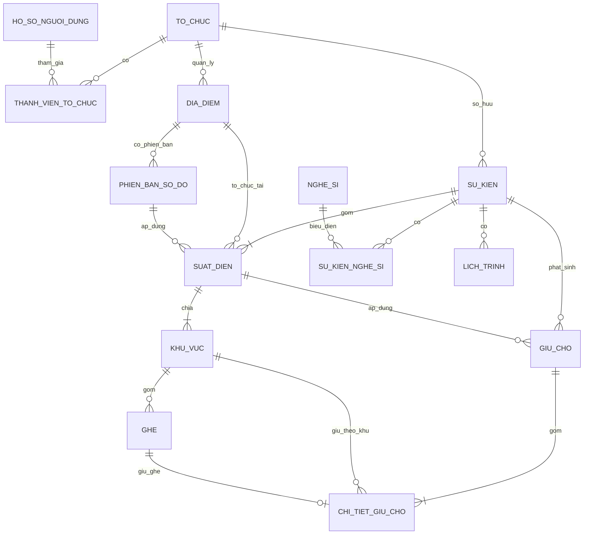

# 03 — Thiết kế cơ sở dữ liệu

## 1. ERD cốt lõi

## 2. Data dictionary cốt lõi

| Bảng | Khóa chính | Vai trò | Ràng buộc đáng chú ý |
|---|---|---|---|
| `TO_CHUC` | `ToChucID` UUID | Tenant/BTC | `Slug` unique, trạng thái hoạt động/tạm khóa |
| `HO_SO_NGUOI_DUNG` | `NguoiDungID` UUID | Hồ sơ gắn Auth | Cascade khi xóa auth user |
| `THANH_VIEN_TO_CHUC` | `ID` UUID | RBAC đa tổ chức | Unique `(ToChucID, NguoiDungID)`; role enum |
| `SU_KIEN` | `SuKienID` serial | Aggregate sự kiện | Thuộc `ToChucID`; `Slug` unique; trạng thái công bố |
| `SUAT_DIEN` | `SuatDienID` bigserial | Lần diễn/bán riêng | Unique `(SuKienID, Slug)`; kiểm tra thời gian |
| `DIA_DIEM` | `DiaDiemID` bigserial | Địa điểm tái sử dụng | Thuộc tổ chức, sức chứa > 0 |
| `PHIEN_BAN_SO_DO` | UUID | Version sơ đồ | Unique `(DiaDiemID, SoPhienBan)`; có cờ khóa |
| `KHU_VUC` | `KhuVucID` serial | Hạng vé/phân khu | Unique `(SuatDienID, MaKhuVuc)`; giá >= 0 |
| `GHE` | `GheID` serial | Ghế vật lý | Unique `(KhuVucID, MaGheDayDu)`; trạng thái realtime |
| `GIU_CHO` | `GiuChoID` UUID | Header giữ chỗ | Có session, show, `HetHanLuc`, status enum |
| `CHI_TIET_GIU_CHO` | `ID` bigserial | Vé/ghế trong hold | Số lượng 1–4; ghế nullable cho khu đứng |
| `NGHE_SI` | `NgheSiID` serial | Nghệ sĩ | Dữ liệu extension của concert |
| `SU_KIEN_NGHE_SI` | `ID` serial | Quan hệ N-N | Unique event–artist |
| `LICH_TRINH` | `LichTrinhID` serial | Timeline event | Giờ kết thúc > giờ bắt đầu |

## 3. Ràng buộc đảm bảo toàn vẹn

- Khóa ngoại theo chuỗi tổ chức → sự kiện → suất diễn → khu vực → ghế.
- Trigger kiểm tra `KHU_VUC.SuatDienID` thật sự thuộc `SuKienID` trong giai đoạn tương thích.
- `tao_giu_cho` chạy trong transaction, khóa record bằng `FOR UPDATE`, kiểm tra tổng số lượng 1–4 và tồn khả dụng.
- Partial index trên giữ chỗ đang hoạt động/hết hạn và chi tiết ghế hỗ trợ truy vấn cạnh tranh.
- RLS tách public read của event công khai với quyền manage theo membership/role.

## 4. Phần chưa có trong schema Sprint 1

Các thực thể `DON_HANG`, `CHI_TIET_DON_HANG`, `THANH_TOAN`, `WEBHOOK_EVENT`, `VE_DIEN_TU`, `QR_TOKEN`, `HOAN_TIEN`, `CHECK_IN` và `WAITING_ROOM` chưa phải phần hoàn chỉnh của Sprint 1. Khi bổ sung phải nối từ `GIU_CHO(CONVERTED)` sang đơn hàng theo cơ chế idempotency, không tái sử dụng trạng thái giữ chỗ làm thanh toán.

