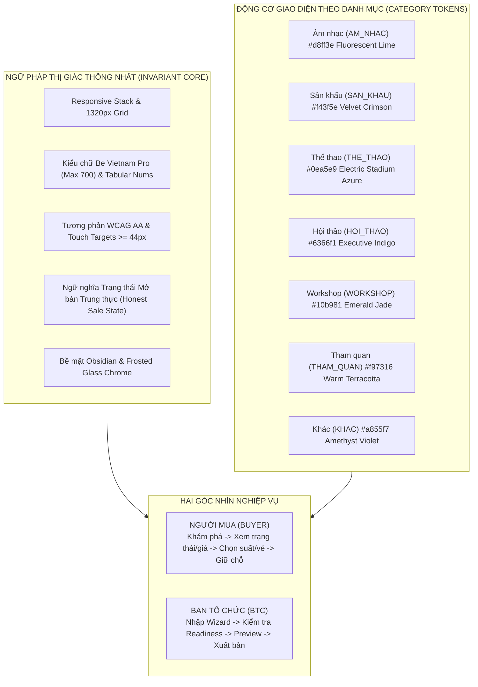
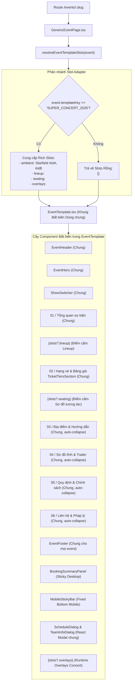

# 07 — Đặc tả Hệ thống Thiết kế EventTicketing (Design System Specification)

> **Tài liệu tham chiếu chuẩn hóa giao diện Sprint 1**  
> **Phiên bản:** 1.0.0 — Ngày cập nhật: 27/10/2026  
> **Trạng thái:** Implementation-grounded draft — visual artifact pending  
> **Phạm vi áp dụng:** Toàn bộ giao diện Người mua vé (Buyer Portal / Marketplace / Public Event Detail) và Ban tổ chức (Organizer Studio / BTC Portal).  
> **Tài liệu liên đới:** [`01_SRS_REQUIREMENTS.md`](./01_SRS_REQUIREMENTS.md), [`02_ANALYSIS_AND_SYSTEM_DESIGN.md`](./02_ANALYSIS_AND_SYSTEM_DESIGN.md), [`03_DATABASE_DESIGN.md`](./03_DATABASE_DESIGN.md), [`04_UI_CONSISTENCY_ADR.md`](./04_UI_CONSISTENCY_ADR.md).

---

## 1. Tầm nhìn, Nguyên tắc thiết kế & Cá tính thương hiệu (Brand Character & Principles)

Hệ thống thiết kế **EventTicketing** được xây dựng dựa trên sự kế thừa và tiến hóa trực tiếp từ trải nghiệm sân khấu điện ảnh (Cinematic Dark-Stage) của *Super Concert 2026*, kết hợp với kỷ luật công thái học của một trung tâm điều hành tiện ích (Utilitarian Command Center) dành cho Ban tổ chức (BTC).

Hệ thống thiết kế này không sáng tạo lại nhận diện thương hiệu một cách tùy tiện, mà giải quyết mâu thuẫn cốt lõi giữa hai chủ thể sử dụng:
1. **Người mua vé (Buyer):** Cần khám phá sự kiện cuốn hút, nhận diện tức thì trạng thái mở bán và mức giá minh bạch, thao tác mượt mà khi chọn suất diễn/hạng vé/chỗ ngồi trên cả desktop lẫn mobile, và tuyệt đối an tâm trong tiến trình đặt vé/giữ chỗ 5 phút.
2. **Ban tổ chức (BTC / Organizer):** Cần một môi trường thiết kế cấu trúc chặt chẽ, cho phép nhập liệu qua Wizard từng bước, xem trước bản nháp trung thực (WYSIWYG) và xuất bản sự kiện đạt ngay độ hoàn thiện thị giác cao cấp mà **không đòi hỏi đội ngũ kỹ thuật phải can thiệp code riêng lẻ**.



### 1.1. Ba nguyên tắc thiết kế bất biến (Invariants)
1. **Một cấu trúc giải phẫu duy nhất (Unified Component Anatomy):** Sự kiện siêu đại nhạc hội (*Super Concert*) và các sự kiện do BTC tự tạo (Hội thảo, Kịch nói, Thể thao, Workshop...) sử dụng **cùng một cây giao diện `EventTemplate`**. Không tạo component tree song song hay phân nhánh HTML fragment riêng.
2. **Cá nhân hóa theo Danh mục, Bất biến theo Bố cục (Category Accent vs Layout Invariance):** Mỗi danh mục sự kiện được tự do thay đổi mã màu điểm nhấn (`--et-cat-accent`, glow, badge), nhưng hệ số khoảng cách (spacing scale), phân cấp kiểu chữ (typography scale), cấu trúc thẻ thông tin, độ bo góc và ngữ nghĩa trạng thái bán là **bất biến tuyệt đối**.
3. **Trung thực về trạng thái và hành động (Honest State & Action Semantics):** Giao diện không bao giờ hiển thị nút mua vé khi sự kiện đã đóng bán (`CLOSED`), sắp mở bán (`UPCOMING`) hoặc đã hết vé (`SOLD_OUT`). Nếu một hạng vé hết chỗ, trạng thái nút phải là disabled với nhãn giải thích rõ ràng.

### 1.2. Kỷ luật tham chiếu từ Wix Studio & OpenDesign (Reference Principles & Sources)
Codebase không sử dụng hạ tầng Wix Studio CMS hay hosting ngoài, nhưng áp dụng nghiêm ngặt các nguyên lý thiết kế hệ thống từ tài liệu chính thức của Wix Studio và giải pháp design system của OpenDesign:
- **Tài sản thiết kế tái sử dụng (Reusable Design System):** Mọi thành phần UI được mô-đun hóa thành các component độc lập (`EventHeader`, `EventHero`, `ShowSwitcher`, `TicketTiersSection`, `BookingSummaryPanel`, `MobileStickyBar`).
- **Site Styles thống nhất (Global Theme Cascade):** Kiểm soát kiểu chữ, khoảng cách, mã màu qua CSS Custom Properties tại `:root`, cho phép chuyển đổi chế độ giao diện một cách nhất quán.
- **Bố cục Flexbox/Grid phản hồi linh hoạt (Fluid Responsive Layout):** Sử dụng các hàm `clamp()` cho typography và fluid containers, kết hợp CSS Grid `minmax()` để loại bỏ hiện tượng tràn viền.
- **Kỷ luật điểm ngắt (Breakpoint Discipline):** Thiết lập quy tắc cascade từ Desktop màn hình rộng (1440px), Desktop tiêu chuẩn (1024px), Tablet (768px) xuống Mobile nhỏ (375px–320px).

**Tài liệu tham chiếu chính thức:**
- Wix Studio — About Wix Studio: https://support.wix.com/en/article/about-wix-studio
- Wix Studio — Creating responsive sites: https://support.wix.com/en/article/creating-responsive-sites-with-wix
- Wix Studio — Creating and managing design libraries: https://support.wix.com/en/article/studio-editor-creating-and-managing-design-libraries
- OpenDesign — Design System Solutions: https://open-design.ai/solutions/design-system/

---

## 2. Hợp đồng Design Tokens (Token Contract)

Toàn bộ hệ thống tokens được chuẩn hóa tại [`src/index.css`](../../src/index.css), [`src/components/event-template/event-template.css`](../../src/components/event-template/event-template.css) và [`src/components/organizer-ui/organizer-ui.css`](../../src/components/organizer-ui/organizer-ui.css).

### 2.1. Màu sắc nền tảng (Base & Neutral Surfaces)

| Token CSS | Giá trị HEX / RGBA | Vai trò sử dụng |
|---|---|---|
| `--et-base-obsidian` | `#06080d` | Màu nền tối tuyệt đối của Shell chi tiết sự kiện |
| `--et-surface-stage` | `#0c1527` | Nền cinematic body phối hợp starfield |
| `--et-surface-luminous` | `#f8f9fb` | Bề mặt nền sáng của khối nội dung chi tiết (`.et-body-surface`) |
| `--et-surface-card-light` | `#ffffff` | Nền thẻ hạng vé, thẻ thông báo trên nền sáng |
| `--et-border-hairline` | `rgba(255, 255, 255, 0.08)` | Đường viền mảnh 1px trên nền tối (Header, Meta card) |
| `--et-border-light-subtle`| `rgba(15, 23, 42, 0.08)` | Đường viền thẻ 1px trên nền sáng |
| `--org-bg` | `#090c0a` | Nền tối graphite của không gian làm việc BTC |
| `--org-surface` | `#101512` | Bề mặt chính của các khung bảng điều khiển BTC |
| `--org-surface-raised` | `#161c18` | Bề mặt nâng nổi (Card, Header, Modal) trong BTC Studio |
| `--org-border-default` | `rgba(255, 255, 255, 0.14)` | Đường viền tiêu chuẩn của các input và card trong BTC |

### 2.2. Bảng màu Danh mục Sự kiện (Category Theme Engine)
Được định nghĩa tại [`src/domain/categoryThemes.js`](../../src/domain/categoryThemes.js):

| Mã danh mục (`key`) | Tên hiển thị (`label`) | Accent (`primary`) | Highlight (`primaryLight`) | Badge Background (`badgeBg`) | Vệt sáng (`glow`) |
|---|---|---|---|---|---|
| `AM_NHAC` | Âm nhạc | `#d8ff3e` (Lime) | `#e8ff6b` | `rgba(216, 255, 62, 0.14)` | `rgba(216, 255, 62, 0.22)` |
| `SAN_KHAU` | Sân khấu | `#f43f5e` (Crimson) | `#fb7185` | `rgba(244, 63, 94, 0.14)` | `rgba(244, 63, 94, 0.22)` |
| `THE_THAO` | Thể thao | `#0ea5e9` (Azure) | `#38bdf8` | `rgba(14, 165, 233, 0.14)` | `rgba(14, 165, 233, 0.22)` |
| `HOI_THAO` | Hội thảo | `#6366f1` (Indigo) | `#818cf8` | `rgba(99, 102, 241, 0.14)` | `rgba(99, 102, 241, 0.22)` |
| `WORKSHOP` | Workshop | `#10b981` (Emerald) | `#34d399` | `rgba(16, 185, 129, 0.14)` | `rgba(16, 185, 129, 0.22)` |
| `THAM_QUAN` | Tham quan | `#f97316` (Terracotta)| `#fb923c` | `rgba(249, 115, 22, 0.14)` | `rgba(249, 115, 22, 0.22)` |
| `KHAC` | Sự kiện khác | `#a855f7` (Amethyst) | `#c084fc` | `rgba(168, 85, 247, 0.14)` | `rgba(168, 85, 247, 0.22)` |

> **Quy tắc chuẩn hóa:** Các bí danh như `TRIEN_LAM` được map về `THAM_QUAN`, `CONG_NGHE` map về `HOI_THAO`, `GIAI_TRI` map về `AM_NHAC`. Khi dữ liệu danh mục rỗng hoặc không xác định, luôn fallback an toàn về `KHAC`.

### 2.3. Màu sắc Trạng thái & Phản hồi Nghiệp vụ (Semantic Status)

| Trạng thái | Tone | Màu Text | Màu Nền Badge | Viền Badge | Ý nghĩa hiển thị |
|---|---|---|---|---|---|
| `ON_SALE` | `emerald` | `#6ee7b7` (Dark) / `#059669` (Light) | `rgba(16, 185, 129, 0.12)` | `rgba(16, 185, 129, 0.35)` | Đang mở bán vé (kèm Live Pulse Dot) |
| `UPCOMING`| `amber` | `#fde047` | `rgba(245, 158, 11, 0.12)` | `rgba(245, 158, 11, 0.35)` | Sắp mở bán vé |
| `SOLD_OUT`| `rose` | `#fca5a5` (Dark) / `#dc2626` (Light) | `rgba(239, 68, 68, 0.12)` | `rgba(239, 68, 68, 0.35)` | Toàn bộ hoặc hạng vé đã bán hết |
| `CLOSED` | `slate` | `#cbd5e1` | `rgba(148, 163, 184, 0.12)` | `rgba(148, 163, 184, 0.25)` | Đã đóng cổng bán vé |

### 2.4. Typography & Bảo vệ dấu tiếng Việt (Typography Contract)

Hệ thống sử dụng phông chữ duy nhất **Be Vietnam Pro** cho cả nội dung thông thường và tiêu đề thương hiệu. Phông chữ này hỗ trợ glyphs tiếng Việt đầy đủ với các dấu thanh đặc thù (hỏi, ngã, nặng, móc ơ/ư).

```css
/* Typography Tokens tại src/index.css */
--font-sans: 'Be Vietnam Pro', system-ui, -apple-system, BlinkMacSystemFont, 'Segoe UI', Roboto, sans-serif;
--font-display: 'Be Vietnam Pro', system-ui, -apple-system, BlinkMacSystemFont, sans-serif;
--font-mono: ui-monospace, SFMono-Regular, Menlo, Monaco, Consolas, monospace;

/* Giới hạn trọng lượng phông: Cấm triệt để weight 800/900 trong template sự kiện */
--font-weight-regular: 400;
--font-weight-medium: 500;
--font-weight-semibold: 600;
--font-weight-bold: 700;

/* Chiều cao dòng (Line Height) bảo vệ dấu tiếng Việt không bị cắt xén */
--leading-tight: 1.15;   /* Tiêu đề Hero (tối thiểu 1.08 theo invariant kiểm thử) */
--leading-snug: 1.3;    /* Tiêu đề cấp 2, 3 */
--leading-normal: 1.5;  /* Thân bài chuẩn */
--leading-relaxed: 1.65;/* Khối mô tả văn bản dài */

/* Khoảng cách chữ (Tracking): Cấm negative tracking quá gắt gây dính dấu tiếng Việt */
--tracking-tight: -0.015em;
--tracking-normal: 0em;
--tracking-wide: 0.03em;
--tracking-kicker: 0.08em;
```

**Thang đo chữ phản hồi (Fluid Type Scale):**
- `--text-xs`: `clamp(0.75rem, 0.72rem + 0.15vw, 0.8125rem)` (12px – 13px) *(Không bao giờ dùng font dưới 12px trong template công khai và dưới 11px trong Studio BTC)*.
- `--text-sm`: `clamp(0.8125rem, 0.78rem + 0.18vw, 0.875rem)` (13px – 14px).
- `--text-base`: `clamp(0.9375rem, 0.9rem + 0.2vw, 1rem)` (15px – 16px).
- `--text-lg`: `clamp(1.0625rem, 1rem + 0.35vw, 1.1875rem)` (17px – 19px).
- `--text-xl`: `clamp(1.25rem, 1.18rem + 0.4vw, 1.375rem)` (20px – 22px).
- `--text-2xl`: `clamp(1.5rem, 1.35rem + 0.75vw, 1.75rem)` (24px – 28px).
- `--text-3xl`: `clamp(1.875rem, 1.65rem + 1.1vw, 2.25rem)` (30px – 36px).
- `--text-4xl`: `clamp(2.25rem, 1.95rem + 1.5vw, 2.75rem)` (36px – 44px).
- `--text-hero`: `clamp(2.25rem, 1.85rem + 2vw, 3.5rem)` (36px – 56px).

### 2.5. Số học dạng bảng (Tabular Numerics)
Để tránh hiện tượng co giãn giật cục khi đồng hồ đếm ngược nhảy giây hoặc khi người dùng lướt qua bảng giá vé, toàn bộ các thành phần giá trị số phải áp dụng token:
```css
.et-num, .et-price, .et-countdown-val, .tabular-nums {
  font-variant-numeric: tabular-nums;
  font-feature-settings: 'tnum' 1;
}
```

### 2.6. Spacing, Radius & Elevation
- **Touch Target tối thiểu:** Mọi thành phần tương tác (nút bấm, liên kết, input, chip) đều phải có kích thước tối thiểu **44px × 44px**.
- **Border Radius:**
  - Micro / Badges: `4px` (`--org-radius-sm`) đến `6px`.
  - Buttons / Inputs / Show Pills: `8px` đến `10px` (`--org-radius-md`).
  - Cards / Content Boxes: `12px` đến `16px` (`--org-radius-lg`).
  - Hero Countdown Box / Modals: `18px` đến `20px`.
- **Elevation & Frosted Glass:**
  - Header: `background: rgba(6, 8, 13, 0.85); backdrop-filter: blur(18px);`
  - Mobile Sticky: `background: rgba(10, 15, 26, 0.94); backdrop-filter: blur(20px);`
  - Modal Backdrop: `background: rgba(0, 0, 0, 0.75); backdrop-filter: blur(8px);`
  - Box Shadow: `0 12px 36px rgba(15, 23, 42, 0.08)` trên nền sáng, `0 16px 48px rgba(0, 0, 0, 0.5)` trên nền tối.

### 2.7. Motion Choreography & Reduced Motion

Hệ thống áp dụng chuyển động tuần tự (Sequential Staged Entrance), tạo cảm giác sân khấu mở màn:
- Easing: `--ease-editorial: cubic-bezier(0.16, 1, 0.3, 1)`.
- Duration: `--duration-fast: 160ms`, `--duration-normal: 260ms`, `--duration-staged: 380ms`, `--duration-hero: 520ms`.
- Stagger Trật tự:
  1. `et-hero-badges`: trượt xuống nhẹ (0ms – 380ms).
  2. `et-hero-title`: cuộn lên (60ms – 520ms).
  3. `et-hero-meta-grid` & `et-hero-actions`: cuộn lên (120ms – 520ms).
  4. `et-countdown`: cuộn lên (180ms – 520ms).

> [!IMPORTANT]
> **Hợp đồng Hỗ trợ Khuyết tật Chuyển động (WCAG Reduced Motion):**
> Khi người dùng kích hoạt `prefers-reduced-motion: reduce`, toàn bộ hoạt ảnh, vệt sáng xoay (`border-beam`), và hiệu ứng chuyển động bị triệt tiêu ngay lập tức (`animation: none !important; transition-duration: 0.001ms !important`). Các phần tử **phải giữ nguyên `opacity: 1 !important`**, tuyệt đối không để nội dung bị kẹt ở trạng thái mờ ẩn.

### 2.8. Điểm ngắt Responsive (Breakpoints)
- **Compact Mobile (320px – 390px):** Ẩn các nút phụ trợ (như nút timeline thu nhỏ), co gọn padding viền còn 12px–14px để bảo vệ diện tích nút CTA chính không bị tràn màn hình.
- **Mobile tiêu chuẩn (391px – 767px):** Bố cục 1 cột dọc hoàn toàn. Header ẩn chữ "Quay lại" (chỉ giữ icon), nút CTA header co về nhãn ngắn ("Vé" / "Sơ đồ"). Thẻ hạng vé xếp dọc.
- **Tablet (768px – 1023px):** Header mở rộng đầy đủ. Hero chuyển sang 1 cột lớn. Khối Booking Summary chuyển về dạng thanh cố định đáy màn hình (`MobileStickyBar`).
- **Desktop tiêu chuẩn (1024px – 1439px):** Bố cục 2 cột bất đối xứng (`minmax(0, 1.25fr)` và `minmax(360px, 0.75fr)`). Booking Summary Panel chuyển sang chế độ sticky bên phải (`top: 88px`).
- **Màn hình rộng (>= 1440px):** Độ rộng nội dung tối đa được kẹp chặt ở mức `max-width: 1320px`, căn giữa màn hình với padding hai bên thích ứng `clamp(16px, 4vw, 48px)`.

---

## 3. Cấu trúc Component cốt lõi & Trạng thái (Core Components & States)

### 3.1. Header / Navigation
- **Marketplace Header (`SiteChrome` / `EventCatalog`):** Logo `EVENTTICKETING` (chữ "ENT" mang accent lime), ô tìm kiếm đa năng tích hợp nút xóa nhanh, liên kết khám phá, nút chuyển sang cổng BTC (`Dành cho BTC`), và cụm đăng nhập/tài khoản.
- **Event Header (`EventHeader`):** 
  - Nút Back (`et-nav-back-link`) có touch target >= 44px; trên màn hình < 768px tự động ẩn nhãn chữ, chỉ giữ icon chevron để tránh quấn dòng.
  - Logo thương hiệu kèm huy hiệu chữ danh mục (`et-brand-badge`).
  - Thanh điều hướng nhanh: Đối với Super Concert hiển thị neo đến `#artist-lineup`, `#pricing-section`, `#seating-section`; với sự kiện thông thường hiển thị neo `#tickets`, `#venue`.
  - Nút mở lịch trình sự kiện (`et-nav-timeline-btn`): Chỉ hiển thị khi sự kiện có dữ liệu lịch trình (`hasSchedule === true`), ẩn khi màn hình < 390px.
  - Header CTA phản ánh chính xác trạng thái mở bán, hiển thị nhãn compact trên mobile (`et-cta-label-compact`).

### 3.2. Thẻ sự kiện (Event Card)
- **Marketplace Event Card (`EventCatalog`):**
  - Tỷ lệ ảnh cover chuẩn 16:9 với lớp phủ gradient tối và hiệu ứng phóng nhẹ khi hover (`scale: 1.02`).
  - Huy hiệu danh mục ở góc trên bên trái mang màu nền và viền từ Theme Engine.
  - Huy hiệu trạng thái mở bán ở góc phải.
  - Tiêu đề tối đa 2 dòng, tự động cắt bằng ellipsis (`-webkit-line-clamp: 2`).
  - Hàng thông tin phụ: Ngày giờ bắt đầu (format tiếng Việt), tên địa điểm, số lượng suất diễn khả dụng.
- **Organizer Event Card (`OrganizerEventCard`):**
  - Thiết kế dạng danh sách quản trị bảng điều khiển với nền graphite `#131915`.
  - Chip trạng thái xuất bản: `Đã công bố` (xanh lá), `Bản nháp` (xám slate), `Đã ẩn` (vàng hổ phách).
  - Tóm tắt chỉ số: Số suất diễn, tổng số vé cấu hình, ngày tạo.
  - Nhóm nút thao tác: Sửa sự kiện (mở Wizard), Xem trước (mở link công khai với cờ preview), Xóa bản nháp (nếu có quyền quản trị).

### 3.3. Hero Section (`EventHero`)
- **Giải phẫu khối:** 
  - Lớp nền đa tầng: Ảnh banner mờ kết hợp gradient che phủ và vệt sáng danh mục (`et-stage-ambient`).
  - Cụm huy hiệu (`et-hero-badges`): Huy hiệu danh mục, huy hiệu số suất diễn, huy hiệu trạng thái mở bán.
  - Tiêu đề Hero (`et-hero-title`): Font weight tối đa 700, giữ nguyên chữ hoa/thường tự nhiên (natural case), cấm uppercase toàn bộ gây cứng nhắc, chiều cao dòng >= 1.15 bảo vệ dấu.
  - Slogan sự kiện (`et-hero-slogan`): Tự động loại bỏ các mã enum thô (ví dụ: `AM_NHAC`, `DEFAULT`) bằng hàm `normalizeEventSlogan`.
  - Khối thông tin nhanh (`et-hero-meta-grid`): Thời gian, địa điểm, sức chứa/quy mô.
  - Khối đếm ngược (`et-countdown-card`): Khung đếm ngược 4 đơn vị (Ngày, Giờ, Phút, Giây) với đường viền xoay laser (`countdown-border-beam`) và chữ số tabular.

### 3.4. Thanh chọn Suất diễn (`ShowSwitcher`)
- Hiển thị dưới dạng thanh trượt ngang có thể cuộn (`overflow-x: auto`) không làm vỡ khung nhìn.
- Mỗi suất diễn hiển thị dưới dạng một pill bo góc gồm: Tên suất diễn (ví dụ: "Đêm diễn chính", "Ngày 1 · Khởi động") và ngày giờ.
- Suất diễn đang chọn nhận class `.is-active`, viền và nền mang accent color của danh mục, chữ số giờ phát sáng nhẹ.

### 3.5. Thẻ Hạng vé (`TicketTiersSection`)
- Lưới thẻ tự co giãn (`repeat(auto-fill, minmax(280px, 1fr))`).
- Đường line nhấn đầu thẻ (`et-tier-accent-bar`) mang màu riêng của hạng vé (từ trường CSDL `KHU_VUC.MauSac` hoặc fallback về accent danh mục).
- Tên hạng vé và huy hiệu tình trạng chỗ: `Còn vé` (xanh ngọc) hoặc `Hết vé` (đỏ cờ).
- Mức giá định dạng tiền tệ VND chuẩn mực (`formatMoney`: `xxx.xxx ₫`, hiển thị `0 ₫ (Miễn phí)` nếu giá bằng 0).
- Danh sách quyền lợi (`et-tier-benefits`): Phân tích tự động từ chuỗi văn bản phân tách bởi dấu xuống dòng, gạch đầu dòng (`•`, `-`, `*`) hoặc dấu chấm phẩy (`;`).
- Nút chọn hạng vé (`et-tier-select-btn`): Touch target >= 44px; khi được chọn, đổi màu nền sang accent danh mục.

### 3.6. Bảng ngữ nghĩa Trạng thái Bán & Nút Hành động (Honest CTA Matrix)
Quy tắc xử lý logic do [`src/components/event-template/eventTemplateLogic.js`](../../src/components/event-template/eventTemplateLogic.js) kiểm soát:

| Trạng thái Sự kiện | Tình trạng Chọn Hạng vé | Trạng thái Nút | Nhãn Nút (Generic) | Nhãn Nút (Super Concert) | Hành động (`action`) |
|---|---|---|---|---|---|
| `UPCOMING` | Bất kỳ | Disabled (55% opacity) | `Sắp mở bán` | `Xem sơ đồ & Hạng vé` | Cuộn đến `#tickets` hoặc `#seating-section` để xem thông tin |
| `CLOSED` | Bất kỳ | Disabled (55% opacity) | `Đã đóng bán` | `Xem thông tin & Sơ đồ` | Cuộn xem tư liệu, tuyệt đối không gợi ý mua vé |
| `SOLD_OUT` | Bất kỳ | Disabled (55% opacity) | `Hết vé` | `Xem sơ đồ & Hạng vé` | Khóa chức năng thanh toán |
| `ON_SALE` | Chưa chọn hạng vé | Enabled | `Chọn hạng vé` | `Chọn vé ngay & Sơ đồ` | Cuộn đến bảng vé để người dùng chọn |
| `ON_SALE` | Hạng vé chọn đã hết tồn (`available <= 0`) | Disabled | `Hạng vé đã hết` | `Hạng vé đã hết` | Khóa thanh toán cho hạng vé này |
| `ON_SALE` | Đã chọn vé khả dụng + Có kênh liên hệ | Enabled | `Liên hệ đặt vé` | Chuyển đến sơ đồ / Mở modal hỗ trợ | Mở `BookingAssistModal` |
| `ON_SALE` | Đã chọn vé khả dụng nhưng thiếu kênh hỗ trợ | Disabled | `Chưa có kênh liên hệ` | Khóa | Ngăn ngừa cụt luồng thanh toán |

### 3.7. Bộ điều khiển Form Ban tổ chức (`OrganizerEventWizard`)
- Giao diện làm việc theo Wizard 6 bước chuẩn hóa (`WIZARD_STEP_TITLES`):
  1. *Thông tin cơ bản* (Tên sự kiện, slug, danh mục, khẩu hiệu, mô tả).
  2. *Địa điểm & Suất diễn* (Hình thức tổ chức offline/online/hybrid, địa chỉ, timeline bán vé và editor `LICH_TRINH`).
  3. *Phân khu & Hạng vé* (Mã khu vực, tên hạng vé, giá bán, sức chứa, quyền lợi).
  4. *Hình ảnh & Truyền thông* (URL banner, poster, video trailer, sơ đồ phân khu và lineup nghệ sĩ).
  5. *Quy định & Liên hệ* (Giới hạn độ tuổi, chính sách hoàn hủy, email/hotline, giấy phép).
  6. *Kiểm tra & Xuất bản* (Đánh giá Publish Readiness tự động).
- **Hợp đồng Form Controls:** Mọi input (`.org-input`), dropdown (`.org-select`), textarea (`.org-textarea`) đều có chiều cao tối thiểu **44px**, viền default `rgba(255, 255, 255, 0.14)`, khi focus hiển thị vòng sáng xanh lime `var(--org-lime)` 2px.
- **Hợp đồng Repeatable Content:** Lịch trình và lineup dùng card lặp có số thứ tự, nút thêm/xóa/di chuyển lên–xuống với touch target >=44px, empty state giải thích rõ và kiểm tra lỗi ngay tại dòng. Hai mảng là tùy chọn; để trống thì public template ẩn section hoàn toàn.
- **Hợp đồng đồng bộ:** Cùng một aggregate `FullEventAggregateInput` phải round-trip `schedule`/`artists` qua mock hoặc RPC; lỗi query load phải fail-closed để tránh hiển thị mảng rỗng rồi xóa dữ liệu khi lưu.
- **Quy tắc phi-emoji:** Toàn bộ form và cảnh báo sử dụng bộ icon vector SVG nội bộ ([`OrganizerIcons.tsx`](../../src/components/organizer-ui/OrganizerIcons.tsx)), nghiêm cấm chèn emoji unicode (🚀, 💾, ⚠️, ❌...) vào mã nguồn UI.

### 3.8. Banner Chế độ xem trước (`et-preview-banner`)
- Cố định ở đỉnh màn hình (`sticky top: 0, z-index: 60`) khi sự kiện đang ở trạng thái bản nháp (`publicationStatus === 'BAN_NHAP'`).
- Màu nền cảnh báo hổ phách đậm (`linear-gradient(90deg, #78350f 0%, #451a03 100%)`) kèm viền vàng sáng.
- Huy hiệu `BẢN NHÁP (DRAFT)` và nút bấm `Quay lại Studio BTC` có touch target >= 44px dẫn thẳng về bảng điều khiển quản lý.

### 3.9. Hộp thoại & Modal (`ScheduleDialog` & `BookingAssistModal`)
- Áp dụng kỹ thuật khóa cuộn màn hình nền (`document.body.style.overflow = 'hidden'`).
- Lớp phủ mờ nền (`backdrop-filter: blur(8px)`).
- Hỗ trợ phím `Escape` để đóng modal tức thì.
- Cô lập tiêu điểm bàn phím (Focus Trap qua `Tab` và `Shift+Tab`), khi đóng modal tự động trả tiêu điểm về nút đã kích hoạt nó.

### 3.10. Panel Giữ chỗ Sticky Desktop (`BookingSummaryPanel`)
- Cố định ở cột phải trên desktop (`position: sticky; top: 88px;`).
- Nền trắng tinh khiết `#ffffff`, bóng đổ nhẹ `0 12px 36px rgba(15, 23, 42, 0.08)`.
- Hiển thị tên suất diễn đã chọn, tên hạng vé, đơn giá, tổng tiền tạm tính và nút hành động chính (`et-booking-primary-btn`).
- Dòng chú thích minh bạch quy trình giữ chỗ tối đa 5 phút của Sprint 1 kèm hotline hỗ trợ khẩn cấp.

### 3.11. Thanh CTA Cố định Mobile (`MobileStickyBar`)
- Cố định sát đáy màn hình trên các thiết bị < 1024px (`position: fixed; bottom: 0;`).
- Mặt kính mờ tối màu obsidian đồng nhất cho mọi sự kiện (`rgba(10, 15, 26, 0.94)` kèm `backdrop-filter: blur(20px)`), viền trên hairline sáng.
- Tự động cộng thêm khoảng đệm an toàn `env(safe-area-inset-bottom, 0px)` để tránh bị che bởi thanh điều hướng hệ điều hành iOS/Android.
- Hiển thị giá tối thiểu tính toán tự động từ các hạng vé đang mở (`Math.min(...)`), không hardcode số tiền 800.000 VNĐ.
- Trên màn hình siêu nhỏ (< 380px), tự động ẩn nút phụ (như nút mở lịch trình) để ưu tiên 100% không gian cho nút CTA chính không bị tràn dòng.
- Ẩn hoàn toàn trên màn hình Desktop (>= 1024px) để tránh trùng lặp với `BookingSummaryPanel`.

---

## 4. Hợp đồng Dữ liệu sang Giao diện (Data-to-UI Contract)

### 4.1. Bảng ánh xạ Nguồn Dữ liệu (Database Fields -> UI Components)

| Thực thể / Cột CSDL | Mô hình Public (`PublicEventRecord`) | Component UI Đích | Xử lý khi Dữ liệu Rỗng / Null |
|---|---|---|---|
| `SU_KIEN.TenSuKien` | `event.name` | `EventHero`, `EventHeader`, Header Title | Bắt buộc (Validation chặn null khi tạo) |
| `SU_KIEN.Slogan` | `event.slogan` | `EventHero.et-hero-slogan`, `Overview Heading` | Lọc qua `normalizeEventSlogan`; nếu là enum thô hoặc rỗng thì ẩn hoàn toàn |
| `SU_KIEN.MoTaChiTiet` | `event.description` | `Overview Section (.et-description-text)` | Fallback về văn bản mặc định thông báo đang cập nhật |
| `SU_KIEN.TheLoai` | `event.category` | Theme Tokens (`data-category`), Badge, Kicker | Fallback về `KHAC` (Màu tím Amethyst) |
| `SU_KIEN.AnhBannerUrl` | `event.bannerUrl` | `EventHero` Background Cover | Fallback về `posterUrl`; nếu cả hai rỗng thì dùng nền gradient tối phẳng |
| `SU_KIEN.AnhPosterUrl` | `event.posterUrl` | Hero Aside Poster Thumbnail | Nếu thiếu, ẩn khối poster phụ, hero aside thu gọn |
| `SU_KIEN.VideoTrailerUrl` | `event.trailerUrl` | `EventMediaSection` (Nút xem Trailer) | Tự động ẩn hoàn toàn nút trailer |
| `SU_KIEN.SoDoGheUrl` | `event.seatingMapUrl` | `EventMediaSection` (Ảnh sơ đồ tĩnh) | Tự động ẩn hoàn toàn khối sơ đồ tĩnh |
| `SU_KIEN.GioiHanDoTuoi` | `event.ageRestriction` | `EventPolicySection` | Ẩn dòng thông tin độ tuổi |
| `SU_KIEN.ChinhSachHoanHuy` | `event.refundPolicy` | `EventPolicySection` | Ẩn dòng chính sách hoàn hủy |
| `SU_KIEN.DieuKhoanThamGia` | `event.termsAndConditions`| `EventPolicySection` | Ẩn dòng điều khoản tham gia |
| `SU_KIEN.EmailLienHe` | `event.contactEmail` | `EventContactSection`, `BookingAssistModal` | Ẩn chip email |
| `SU_KIEN.HotlineLienHe` | `event.contactHotline` | `EventContactSection`, `BookingAssistModal` | Ẩn chip hotline |
| `SU_KIEN.FanpageUrl` | `event.fanpageUrl` | `EventContactSection` | Ẩn chip liên kết mạng xã hội |
| `SU_KIEN.GiayPhepSo` | `event.permitNumber` | `EventContactSection` | Ẩn dòng giấy phép pháp lý |
| `SUAT_DIEN.TenSuatDien` | `selectedShow.name` | `ShowSwitcher`, `BookingSummaryPanel` | Lấy tên suất đầu tiên làm mặc định |
| `SUAT_DIEN.ThoiGianBatDau`| `selectedShow.startsAt` | Hero Meta Card, Show Pill | Hiển thị "Đang cập nhật" nếu định dạng ngày sai |
| `KHU_VUC.TenKhuVuc` | `tier.name` | `TicketTiersSection`, `BookingSummary` | Bắt buộc trong danh sách vé |
| `KHU_VUC.GiaVe` | `tier.price` | `TicketTiersSection`, `MobileStickyBar` | `0` hiển thị `Miễn phí`, giá âm bị chặn ở DB |
| `KHU_VUC.MoTa` | `tier.description` | `TicketTiersSection (Benefits List)` | Phân tích thành checklist; nếu rỗng thì không render `<ul>` |
| `LICH_TRINH` | `schedule: PublicScheduleItem[]` | `ScheduleDialog`, Header/Hero Timeline Btn | Nếu không có bản ghi hợp lệ, ẩn hoàn toàn nút lịch trình |

### 4.2. Quy tắc Tự thu gọn Phần nội dung Rỗng (Graceful Section Collapse)
Được hiện thực hóa bởi các hàm kiểm tra điều kiện độc lập tại [`eventTemplateLogic.js`](../../src/components/event-template/eventTemplateLogic.js):
- `hasMediaContent(event)`: Chỉ render `EventMediaSection` nếu có `trailerUrl` HOẶC `seatingMapUrl`.
- `hasVenueContent(event)`: Chỉ render `EventVenueSection` nếu có ít nhất một trong các thông tin: `venueName`, `address`, `locationMode`, `onlineLink`, hoặc `onlineInstructions`.
- `hasPolicyContent(event)`: Chỉ render `EventPolicySection` nếu có ít nhất một trong các điều khoản: `ageRestriction`, `refundPolicy`, hoặc `termsAndConditions`.
- `hasContactContent(event)`: Chỉ render `EventContactSection` nếu có ít nhất một trong các kênh: `contactEmail`, `contactHotline`, `fanpageUrl`, hoặc `permitNumber`.

---

## 5. Quy tắc Template Dùng chung vs Slot Mở rộng (Shared-Template vs Extension-Slots)

### 5.1. Triết lý Kiến trúc Thống nhất
*Super Concert 2026* không còn là một trang biệt lập mà là **một trường hợp cụ thể áp dụng cấu hình mở rộng của `EventTemplate`**. Mọi route xem chi tiết sự kiện công khai đều đi qua component trung tâm [`GenericEventPage.tsx`](../../src/components/GenericEventPage.tsx).



### 5.2. Định nghĩa Typed Extension Slots
Được định nghĩa tại [`src/components/event-template/EventTemplate.tsx`](../../src/components/event-template/EventTemplate.tsx):
```typescript
export type EventTemplateSlots = {
  ambient?: ReactNode;  // Hiệu ứng hạt sao rơi starfield, ánh sáng nền phụ trợ
  lineup?: ReactNode;   // Danh sách nghệ sĩ biểu diễn dạng thẻ/ảnh chuyên biệt
  seating?: ReactNode;  // Sơ đồ phân khu/ghế tương tác SVG chọn ghế trực tiếp
  overlays?: ReactNode; // Overlays runtime chuyên biệt cho concert (seat tooltip, toast, booking hold)
  modals?: ReactNode;   // Tương thích ngược: alias cho overlays
};
```

### 5.3. Kiểm soát Technical Debt & Hoàn thành Lát cắt Footer/Runtime Overlays
- **Hoàn thành lát cắt UI Consistency Footer:** Toàn bộ footer và modal thông tin đề tài đã được chuyển thành React component dùng chung (`EventFooter.tsx` và `TeamInfoDialog.tsx`) cho mọi loại sự kiện.
- **Gỡ bỏ cầu nối Custom Event:** Toàn bộ sự kiện `eventticketing:open-schedule` và các dispatcher inline đã được loại bỏ triệt để khỏi mã nguồn sản xuất (`EventTemplate.tsx`, `ConcertSections.tsx`, `footer-modals.html`, `hero.html`). Các luồng mở lịch trình và thông tin nhóm 100% sử dụng React callbacks và state có kiểm soát.
- **React hóa Runtime Overlays:** `SeatTooltip`, `RuntimeToastContainer` và `BookingHoldModal` hiện do React sở hữu; `footer-modals.html` không còn markup runtime. Adapter `runtimeOverlays` truyền payload có cấu trúc từ seat runtime, loại bỏ `innerHTML` injection và global `simulateNextSprint`.
- **Accessibility & Truthfulness:** Modal dùng thời gian hold thực, focus trap, Escape/backdrop close, trả focus; nội dung nêu rõ hold tạm thời chưa phải giao dịch hoàn tất. Toast timer được cleanup khi unmount và tooltip giữ nguyên nội dung khi chỉ cập nhật tọa độ.
- **Lộ trình Sprint 2:** Nếu migrate SVG Super Concert sang React, phải giữ nguyên hình học móng ngựa, animated camera, tooltip, drill-down ghế, inventory và hành vi chọn vé bằng visual-regression tests; không thay bằng layout tự sinh chung.

---

## 6. Tiêu chí Chấp thuận Responsive & Accessibility (Acceptance Criteria)

### 6.1. Ma trận Kiểm thử Responsive

| Điểm ngắt Viewport | Bố cục Thân trang | Hành vi Header | Hành vi Khối Booking | Tiêu chí Đạt (Pass Criteria) |
|---|---|---|---|---|
| **320px – 375px** | 1 cột dọc | Ẩn chữ Back, ẩn nút timeline, co padding viền | Hiện `MobileStickyBar` (Ẩn nút phụ, chỉ giữ CTA chính) | Không vỡ layout, không tràn viền ngang (`overflow-x: clip`), touch target >= 44px |
| **376px – 767px** | 1 cột dọc | Ẩn chữ Back, hiện nút timeline thu nhỏ, CTA nhãn "Vé" | Hiện `MobileStickyBar` đầy đủ | Thẻ hạng vé xếp dọc 1 cột, text không đè nhau |
| **768px – 1023px** | 1 cột dọc rộng | Mở rộng đầy đủ navigation link | Hiện `MobileStickyBar`, ẩn `BookingSummaryPanel` | Khung nhìn thoáng, các thẻ meta hiển thị dạng lưới 2 cột |
| **1024px – 1439px**| 2 cột (1.25fr + 0.75fr) | Điều hướng desktop đầy đủ | Ẩn `MobileStickyBar`, kích hoạt `BookingSummaryPanel` sticky | Khối đặt vé trượt mượt mà dọc thân trang khi scroll |
| **>= 1440px** | 2 cột trong container 1320px | Căn giữa trang | Sticky bên phải nội dung | Hai bên lề đối xứng, hình ảnh nền bao phủ toàn màn hình |

### 6.2. Tiêu chuẩn Tiếp cận (WCAG 2.1 AA Criteria)
1. **Độ tương phản màu sắc (Contrast Ratio):**
   - Văn bản kích thước thông thường trên nền tối đạt tối thiểu **4.5:1** (Màu `#f1f5f9` trên nền `#06080d` đạt 16.8:1).
   - Văn bản lớn / Tiêu đề đạt tối thiểu **3.0:1**.
   - Các nhãn trạng thái sale (`emerald`, `amber`, `rose`, `slate`) được tính toán độ tương phản chuẩn mực giữa chữ và nền badge.
2. **Focus Visible Contract:** Mọi phần tử có thể nhận focus (`<a>`, `<button>`, `<input>`, `<select>`) đều phải hiển thị viền chỉ báo rõ ràng:
   ```css
   :focus-visible {
     outline: 2px solid var(--et-cat-accent-light, #fbbf24) !important;
     outline-offset: 2px !important;
   }
   ```
3. **Kích thước vùng bấm (Touch Target):** Mọi nút bấm, liên kết điều hướng và ô nhập liệu đều có `min-height: 44px` và `min-width: 44px`.
4. **Hỗ trợ Đầu đọc Màn hình (Screen Reader / ARIA):**
   - Các vùng nội dung chính được đánh dấu rõ ràng: `<header>`, `<main className="et-main">`, `<section aria-labelledby="...">`.
   - Các nút chỉ có biểu tượng phải có `aria-label` mô tả hành động (ví dụ: `aria-label="Đóng hộp thoại"`, `aria-label="Xóa từ khóa tìm kiếm"`).
   - Điểm sáng trang trí và starfield được đánh dấu `aria-hidden="true"` để không làm phiền công cụ trợ thính.
5. **Chữ số và dấu tiếng Việt:** Tuyệt đối không dùng kích thước chữ dưới 12px trong trang sự kiện và dưới 11px trong Studio BTC. Chiều cao dòng luôn giữ tối thiểu 1.15 để các dấu nặng, hỏi, ngã tiếng Việt hiển thị toàn vẹn.

---

## 7. Kịch bản Kiểm thử Chấp thuận (Acceptance Scenarios)

### Kịch bản 1: Người mua duyệt sự kiện đang mở bán và chọn hạng vé (Buyer Booking Flow)
- **Tiền điều kiện:** Sự kiện ca nhạc đang ở trạng thái `ON_SALE` với 3 hạng vé: VIP (1.500.000 ₫, còn 20 vé), GA (600.000 ₫, còn 100 vé), Early Bird (400.000 ₫, hết vé).
- **Các bước thực hiện:**
  1. Người mua truy cập trang sự kiện. Thấy huy hiệu "Đang mở bán" màu xanh ngọc kèm Live Dot nhấp nháy.
  2. Nút CTA tại Hero hiển thị "Xem hạng vé & Chọn chỗ" (hoặc "Chọn vé ngay & Sơ đồ" với Super Concert).
  3. Người mua click CTA -> màn hình cuộn mượt xuống Section 02 (Bảng hạng vé).
  4. Hạng vé Early Bird hiển thị huy hiệu đỏ "Hết vé", nút chọn bị disabled.
  5. Người mua click chọn hạng vé VIP.
- **Kết quả mong đợi:** Thẻ VIP nhận viền sáng accent danh mục. Khối `BookingSummaryPanel` (desktop) hoặc `MobileStickyBar` (mobile) cập nhật ngay lập tức: Tên hạng vé "VIP", đơn giá "1.500.000 ₫", nút hành động chuyển sang "Liên hệ đặt vé" (hoặc mở luồng thanh toán giữ chỗ 5 phút).

### Kịch bản 2: Người mua xem sự kiện đã kết thúc hoặc đóng bán (Honest State Browsing)
- **Tiền điều kiện:** Sự kiện triển lãm đã qua thời gian mở bán (`databaseSaleStatus = 'DA_DONG_BAN'` hoặc `now >= saleEndsAt`).
- **Các bước thực hiện:**
  1. Người mua truy cập trang sự kiện.
  2. Huy hiệu trạng thái hiển thị "Đã đóng bán" màu xám slate.
  3. Khối đếm ngược Hero hiển thị thông báo "SỰ KIỆN ĐÃ KẾT THÚC" thay vì đồng hồ nhảy giờ.
  4. Người mua cuộn xuống xem thông tin giới thiệu và hạng vé.
- **Kết quả mong đợi:** Toàn bộ các nút CTA trên Header, Hero, Booking Panel và Mobile Bar đều ở trạng thái disabled, nhãn hiển thị "Đã đóng bán" hoặc "Xem thông tin sự kiện", **tuyệt đối không có bất kỳ nút nào ghi "Mua vé ngay" hay "Đặt vé"**.

### Kịch bản 3: Ban tổ chức tạo mới sự kiện qua Wizard và xem trước bản nháp (BTC WYSIWYG Workflow)
- **Tiền điều kiện:** Tài khoản BTC đăng nhập thành công vào `OrganizerPortal`, có quyền `BIEN_TAP` hoặc `QUAN_TRI`.
- **Các bước thực hiện:**
  1. BTC nhấn "Tạo sự kiện mới", Wizard 6 bước xuất hiện với nền tối graphite chuẩn mực, các input cao 44px rõ ràng.
  2. Nhập thông tin: Tên sự kiện "Hội thảo Chuyển đổi số 2026", chọn danh mục `HOI_THAO`, thêm 1 suất diễn và 2 hạng vé.
  3. Nhấn "Lưu bản nháp". Hệ thống ghi nhận trạng thái `BAN_NHAP`.
  4. Nhấn nút "Xem trước (Preview)".
- **Kết quả mong đợi:** Giao diện sự kiện mở ra mang trọn vẹn tông màu tím chàm Indigo (`#6366f1`) của danh mục Hội thảo. Trên đỉnh trang hiển thị `et-preview-banner` màu hổ phách cảnh báo "BẢN NHÁP (DRAFT) — Chỉ hiển thị với Ban tổ chức" kèm nút bấm "Quay lại Studio BTC". Bố cục trang hoàn chỉnh, đẹp mắt mà không cần code thêm bất kỳ dòng CSS nào.

### Kịch bản 4: Ban tổ chức không nhập thông tin tùy chọn (Graceful Degradation Check)
- **Tiền điều kiện:** BTC tạo sự kiện workshop nhưng không có video trailer, không có sơ đồ phân khu tĩnh và chưa công bố chính sách hoàn hủy.
- **Các bước thực hiện:** BTC xuất bản sự kiện và mở xem trang công khai.
- **Kết quả mong đợi:** Các mục `EventMediaSection` và `EventPolicySection` hoàn toàn không hiển thị. Không xuất hiện các khung hình ảnh vỡ, không có thông báo "Chưa có dữ liệu" thừa thãi, các mục có dữ liệu tự động nối liền mạch theo nhịp điệu không gian chuẩn.

---

## 8. Ánh xạ Hiện thực Codebase & Danh mục Tồn đọng (Implementation Mapping & Gap List)

### 8.1. Bảng đối chiếu Tệp tin Triển khai Thực tế

| Nhóm chức năng | Tệp tin nguồn trong Codebase | Vai trò hiện thực |
|---|---|---|
| **Global Tokens & Theme** | [`src/index.css`](../../src/index.css) | Khai báo typography tokens, easing motion, starfield canvas, button glow |
| **Category Theming Engine** | [`src/domain/categoryThemes.js`](../../src/domain/categoryThemes.js) | Danh mục mã màu, nhãn hiển thị, vệt sáng và icon cho 7 nhóm sự kiện |
| **Category Typings** | [`src/domain/categoryThemes.d.ts`](../../src/domain/categoryThemes.d.ts) | TypeScript interfaces cho `CategoryTheme` |
| **Template Logic & Invariants** | [`src/components/event-template/eventTemplateLogic.js`](../../src/components/event-template/eventTemplateLogic.js) | Tính toán đếm ngược, phân tích quyền lợi vé, chuẩn hóa slogan, CTA matrix |
| **Template Stylesheet** | [`src/components/event-template/event-template.css`](../../src/components/event-template/event-template.css) | Quy tắc CSS cho toàn bộ cấu trúc `.et-shell`, responsive, và dark/frosted surface |
| **Master Event Template** | [`src/components/event-template/EventTemplate.tsx`](../../src/components/event-template/EventTemplate.tsx) | Component React hợp nhất render toàn bộ khối nội dung sự kiện |
| **Public Page Entry** | [`src/components/GenericEventPage.tsx`](../../src/components/GenericEventPage.tsx) | Điểm tiếp nhận route chi tiết, phân phối slot Super Concert vs Generic |
| **Header Component** | [`src/components/event-template/EventHeader.tsx`](../../src/components/event-template/EventHeader.tsx) | Navigation bar responsive, back link, brand mark |
| **Hero Component** | [`src/components/event-template/EventHero.tsx`](../../src/components/event-template/EventHero.tsx) | Hero stage, tiêu đề, slogan, thẻ đếm ngược |
| **Ticket Tiers Component** | [`src/components/event-template/TicketTiersSection.tsx`](../../src/components/event-template/TicketTiersSection.tsx) | Danh sách hạng vé, tính khả dụng và chọn vé |
| **Desktop Booking Panel** | [`src/components/event-template/BookingSummaryPanel.tsx`](../../src/components/event-template/BookingSummaryPanel.tsx) | Panel giữ chỗ desktop sticky và modal hỗ trợ đặt vé |
| **Mobile Sticky Bar** | [`src/components/event-template/MobileStickyBar.tsx`](../../src/components/event-template/MobileStickyBar.tsx) | Thanh tác vụ cố định mobile với giá min và CTA an toàn |
| **Schedule Modal** | [`src/components/event-template/ScheduleDialog.tsx`](../../src/components/event-template/ScheduleDialog.tsx) | Modal lịch trình sự kiện hỗ trợ focus trap, Esc, Aria |
| **Footer Component** | [`src/components/event-template/EventFooter.tsx`](../../src/components/event-template/EventFooter.tsx) | Footer sản phẩm dùng chung: brand copy, lịch trình, lưu ý, nhóm 4, cuộn đầu trang |
| **Team Info Modal** | [`src/components/event-template/TeamInfoDialog.tsx`](../../src/components/event-template/TeamInfoDialog.tsx) | Modal thông tin đề tài SRS & nhóm 4 FTU: accessible focus trap, Esc, 44px targets |
| **Seat Map + Hold UI** | [`src/components/event-template/SeatMapSection.tsx`](../../src/components/event-template/SeatMapSection.tsx), [`src/components/event-template/MapToolbar.tsx`](../../src/components/event-template/MapToolbar.tsx), [`src/components/event-template/StadiumOverview.tsx`](../../src/components/event-template/StadiumOverview.tsx), [`src/components/event-template/ZoneSeatGrid.tsx`](../../src/components/event-template/ZoneSeatGrid.tsx), [`src/domain/seatMap.js`](../../src/domain/seatMap.js) | Sơ đồ ghế React dùng chung, SVG sinh từ dữ liệu, tìm kiếm/lọc/zoom, 5 trạng thái ghế, giữ tối đa 4 vé và vòng đời hold trung thực |
| **Runtime Overlays** | [`src/components/ConcertSections.tsx`](../../src/components/ConcertSections.tsx), [`src/components/event-template/SeatTooltip.tsx`](../../src/components/event-template/SeatTooltip.tsx), [`src/components/event-template/RuntimeToastContainer.tsx`](../../src/components/event-template/RuntimeToastContainer.tsx), [`src/components/event-template/BookingHoldModal.tsx`](../../src/components/event-template/BookingHoldModal.tsx), [`src/domain/runtimeOverlays.js`](../../src/domain/runtimeOverlays.js) | React-owned tooltip/toast/hold modal và adapter payload có cấu trúc từ seat runtime |
| **Organizer Stylesheet** | [`src/components/organizer-ui/organizer-ui.css`](../../src/components/organizer-ui/organizer-ui.css) | Hệ thống token graphite, form controls và bố cục Studio BTC |
| **Organizer Wizard** | [`src/components/organizer-ui/OrganizerEventWizard.tsx`](../../src/components/organizer-ui/OrganizerEventWizard.tsx) | Bộ tạo và chỉnh sửa sự kiện 6 bước cho BTC |
| **Organizer Icons** | [`src/components/organizer-ui/OrganizerIcons.tsx`](../../src/components/organizer-ui/OrganizerIcons.tsx) | Thư viện biểu tượng vector chuyên nghiệp, không emoji |
| **Suites Kiểm thử Tự động**| [`tests/event-template.test.mjs`](../../tests/event-template.test.mjs)<br>[`tests/public-schedule.test.mjs`](../../tests/public-schedule.test.mjs)<br>[`tests/category-themes.test.mjs`](../../tests/category-themes.test.mjs)<br>[`tests/organizer-ui.test.mjs`](../../tests/organizer-ui.test.mjs)<br>[`tests/runtime-overlays.test.mjs`](../../tests/runtime-overlays.test.mjs)<br>[`tests/seat-map.test.mjs`](../../tests/seat-map.test.mjs)<br>[`tests/seat-realtime.test.mjs`](../../tests/seat-realtime.test.mjs) | 137 bài kiểm thử xác minh token, CSS, logic, a11y, hold lifecycle, footer/overlay boundary và realtime isolation theo suất diễn |

### 8.2. Danh mục Khoảng cách Kỹ thuật cho Backlog Sprint 2 (Gap List)
1. **Hai chiến lược sơ đồ có ranh giới rõ ràng (Đã giải quyết):** Super Concert giữ sơ đồ SVG chuyên biệt đã nghiệm thu; sự kiện BTC dùng `SeatMapSection` React tự sinh từ catalog. `ConcertSections.SeatingSection` định tuyến bằng `templateKey`, còn `concertRuntime.js` chỉ khởi tạo khi có `#stadium-svg`, nên không can thiệp vào sự kiện generic.
2. **Cầu nối/DOM injection cũ đã được loại bỏ (Đã giải quyết):** `eventticketing:open-schedule`, footer/team modal legacy, toast/modal string injection và global `simulateNextSprint` đã bị gỡ bỏ. Runtime overlay dùng adapter sự kiện typed, có giới hạn rõ ràng.
3. **Thanh toán thực & Khóa chỗ theo thời gian thực:** Sprint 1 giới hạn ở mức mô phỏng giữ chỗ 5 phút và liên hệ hỗ trợ; Sprint 2 sẽ kết nối cổng thanh toán thật (VietQR / VNPay) tích hợp trực tiếp vào `BookingSummaryPanel`.

---

## 9. Compact Handoff Prompt cho OpenDesign Generation

> [!IMPORTANT]
> **Lưu ý trung thực về hiện trạng Visual Artifact:**  
> OpenDesign Cloud bị giới hạn balance; người dùng đã chọn Local Codex và artifact `eventticketing-react-seat-map-local` đã được sinh, mở preview và kéo về máy gồm `seat-selection.html`, `component-spec.md`, `brand-spec.md`. Wix Design System được dùng làm nguồn tham chiếu cho grouped toolbar, segmented control, badge, card và tooltip; dự án không import WDS hay chuyển sang Wix hosting. Mã nguồn, browser QA và **137 bài kiểm thử tự động** vẫn là nguồn sự thật khi nghiệm thu.

Khi thực hiện sinh visual spec hoặc design asset trên OpenDesign Cloud, sử dụng prompt chuẩn hóa dưới đây:

```markdown
Design System Specification for EventTicketing Platform (Web & Mobile Web)
Role: Senior Design Systems Lead & Product UI Architect

Context & Direction:
- Evolve the existing EventTicketing brand (cinematic dark-stage atmosphere meets utilitarian organizer command center).
- Do not create an unrelated rebrand. Both Super Concert 2026 and organizer-created events share one unified layout grammar and component anatomy.
- Reference Wix Studio principles: reusable design assets, site-wide typography/color cascades, responsive grid/stack discipline, and accessibility rigor.

Foundations:
- Typography: 'Be Vietnam Pro' for all titles, display, and body copy. Font weights restricted to 400 (Regular), 500 (Medium), 600 (Semibold), 700 (Bold). Natural title case (no harsh all-caps titles). Line-height >= 1.15 to guarantee Vietnamese diacritics integrity. Tabular numerics (tnum) for prices, dates, and countdown clocks.
- Color Tokens: Base obsidian (#06080d), graphite studio (#090c0a / #101512), luminous editorial body (#f8f9fb / #ffffff).
- Category Accents: Music (#d8ff3e lime), Theatre (#f43f5e crimson), Sports (#0ea5e9 azure), Conference (#6366f1 indigo), Workshop (#10b981 emerald), Tour (#f97316 terracotta), Other (#a855f7 amethyst).
- Elevation & Borders: Hairline 1px borders (rgba(255,255,255,0.08) on dark, rgba(15,23,42,0.08) on light). Frosted glass header and mobile sticky bar with 18-20px backdrop blur.

Core Components & States to Render:
1. Header / Navigation: Frosted chrome, brand badge, compact back link (44px touch target), schedule trigger, responsive CTA.
2. Hero Section: Fluid title clamp(28px, 4.2vw, 52px), slogan, metadata chips, honest sale-state CTA, countdown card with hairline laser trail.
3. Show Switcher: Horizontal scrollable pill bar with active category accent state.
4. Ticket Tiers Grid: Multi-column responsive cards, top accent line, VND price formatting, bulleted benefits list, selection state.
5. Sale-State Matrix: Visual badges for ON_SALE (emerald + live dot), UPCOMING (amber), SOLD_OUT (rose), CLOSED (slate).
6. Desktop Sticky Booking Summary (Right column, 1024px+): White card, tier summary, price breakdown, assist CTA.
7. Mobile Sticky CTA Bar (Bottom fixed, <1024px): Obsidian frosted glass, safe area inset padding, dynamic min-price, primary action.
8. Organizer Studio: 6-step event wizard with 44px input fields, graphite cards, status chips (Published, Draft, Hidden), zero emojis (pure vector icons).
9. Preview Banner: Sticky amber warning strip for organizer draft preview mode.

Accessibility & Responsive Invariants:
- Touch targets >= 44px x 44px. Focus-visible category outline with 2px offset.
- Strictly no font size under 12px in public templates and under 11px in organizer studio.
- Breakpoints: 375px (compact mobile), 768px (tablet stack), 1024px (desktop split), 1440px (1320px max container).
- Full reduced-motion compliance (no animation, opacity 1, zero visual stranding).
```
