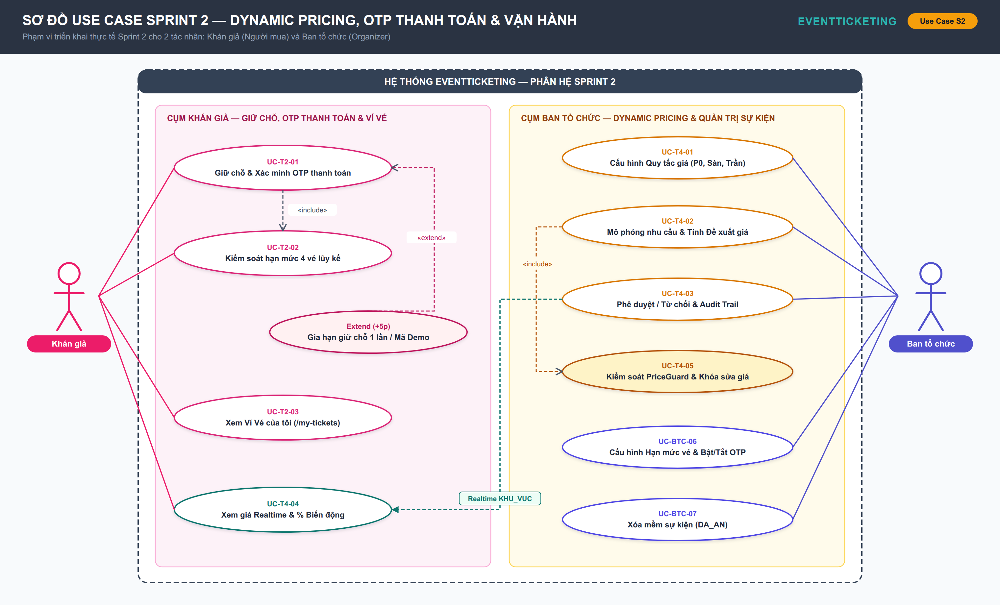

# 01 — Danh mục Use Case & Ma trận Truy vết Sprint 2

> **Mục tiêu:** Liên kết xuyên suốt từ Yêu cầu chức năng/phi chức năng (`FR`/`NFR`) → Use Case → 21 bảng ERD thật → Lớp thiết kế B-C-E → Sequence / Activity Diagram → Migration & Kiểm thử tự động.

---

## 1. Sơ đồ Use Case Sprint 2

*(Bản vector: [uc_sprint2_overview.svg](./images/uc_sprint2_overview.svg))*

---

## 2. Danh mục Use Case Sprint 2 chuẩn hóa

| Mã UC | Tên Use Case | Tác nhân | FR / NFR | Dữ liệu & Nghiệp vụ cốt lõi (khớp mã nguồn) |
|---|---|---|---|---|
| **UC-T2-01** | Giữ chỗ 5 phút & Xác minh OTP khi thanh toán | Khán giả | FR-T2-01, FR-T2-04, NFR-04 | `tao_giu_cho_theo_suat` (không check OTP); `xac_nhan_thanh_toan` kiểm tra `CAU_HINH_SU_KIEN.YeuCauXacMinhOTP`, trả `42501` để gia hạn 1 lần (`gia_han_giu_cho`, `DaGiaHan=TRUE`) và mở `CheckoutOtpDialog` (OTP tươi `moc_otp_moi_nhat() > GIU_CHO.NgayTao` ghi `MocOtpDaDung`, hoặc mã demo `CAU_HINH_DEMO` cho `@demo.vn`). Đăng xuất khi đang giữ chỗ tự động gọi `huy_giu_cho` qua `holdSessionGuard.js`. |
| **UC-T2-02** | Kiểm soát hạn mức vé lũy kế (mặc định 4 vé) | Khán giả | FR-T2-02, NFR-02 | `pg_advisory_xact_lock` theo `(NguoiDungID, SuKienID)`; cộng dồn `ACTIVE` + `CONVERTED` so với `CAU_HINH_SU_KIEN.SoVeToiDaMoiDon` (1..20); chốt giá `CHI_TIET_GIU_CHO.DonGiaChot = KHU_VUC.GiaVeNiemYet`. |
| **UC-T2-03** | Xem Ví Vé của tôi (`/my-tickets`) | Khán giả | FR-T2-05 (mở rộng S2) | `MyTickets` → `TicketWalletService.loadMyTickets()` → RPC `ve_cua_toi()` đọc `GIU_CHO ('CONVERTED')` nối `CHI_TIET_GIU_CHO` (`MaVe`, `DonGiaChot`), `GHE`, `KHU_VUC`, `SUAT_DIEN`, `SU_KIEN`. |
| **UC-T4-01** | Cấu hình Quy tắc giá động (Sàn, Trần, Bước nhảy, Biên độ) | Ban tổ chức | FR-T4-02 | `OrganizerPricingConfig` → `PricingService.savePriceRule()` → RPC `luu_quy_tac_gia()` upsert `QUY_TAC_GIA` (1–1 `KHU_VUC`) & ghi bất biến `NHAT_KY_DINH_GIA`. |
| **UC-T4-02** | Mô phỏng nhu cầu & Tính Đề xuất giá 5 bước | Ban tổ chức | FR-T4-04 | `mo_phong_nhu_cau` (`ban_nhanh`/`ban_cham`/`ban_deu`, ghi `MO_PHONG_GHE`); `lay_so_lieu_dinh_gia` trả `r, u, u_exp, Trem`; `PricingEngine.computePriceProposal()` tính 5 bước; `luu_de_xuat_gia` tạo `DE_XUAT_GIA (CHO_DUYET)`. |
| **UC-T4-03** | Phê duyệt / Từ chối đề xuất giá & Xem Audit Trail | Ban tổ chức | FR-T4-04, NFR-08 | `OrganizerPriceProposals` → `duyet_de_xuat_gia` (khóa `SELECT FOR UPDATE`, kiểm tra xung đột `PT409`, cập nhật `KHU_VUC.GiaVeNiemYet`, ghi bất biến `NHAT_KY_GIA`) hoặc `tu_choi_de_xuat_gia`. |
| **UC-T4-04** | Xem giá Realtime & Badge `%` biến động | Khán giả | FR-T4-04 | `PriceRealtimeService` lắng nghe Supabase Realtime trên `KHU_VUC`; `OfficialSeatingMap` cập nhật giá & badge biến động so với `GiaGoc` (phiếu đang giữ vẫn giữ `DonGiaChot`). |
| **UC-T4-05** | Kiểm soát PriceGuard & Chặn sửa giá trực tiếp | Hệ thống / BTC | FR-T4-02, NFR-08 | `luu_de_xuat_gia` đối chiếu `QUY_TAC_GIA.NgayCapNhat` (ghi `CHAN_DE_XUAT` vào `NHAT_KY_DINH_GIA`); trigger `kiem_soat_doi_gia_truc_tiep` chặn cập nhật trực tiếp `KHU_VUC.GiaVeNiemYet`. |
| **UC-BTC-06** | Cấu hình hạn mức vé & bật/tắt OTP cho sự kiện | Ban tổ chức | FR-T2-01, FR-T2-02 | `OrganizerPurchaseConfig` → `PurchaseConfigService` → RPC `luu_cau_hinh_mua_ve` → trigger `trg_khoa_cau_hinh_mua_ve` & `trg_kiem_soat_cau_hinh_mua_ve` ghi bất biến `NHAT_KY_CAU_HINH_MUA_VE`. |
| **UC-BTC-07** | Xóa mềm sự kiện (`DA_AN`) | Ban tổ chức | FR-T1-03 (mở rộng S2) | `OrganizerEventCard` → `OrganizerService.deleteEvent()` → RPC `xoa_su_kien(p_su_kien_id)` (chủ sở hữu/admin, bản nháp hoặc đã kết thúc, 0 giữ chỗ `ACTIVE`). |

---

## 3. Ma trận Truy vết Kiến trúc 4 chiều Sprint 2

| Mã UC | Bảng ERD thật (21 bảng) | Lớp B-C-E (`Boundary • Control • Entity`) | Sequence & Activity | Migration & Bằng chứng kiểm thử |
|---|---|---|---|---|
| **UC-T2-01** | `GIU_CHO`, `CAU_HINH_SU_KIEN`, `CAU_HINH_DEMO`, `GHE` | `HoldConfirmationDialog`, `CheckoutOtpDialog` • `BookingService`, `OtpService` • `GiuCho`, `CauHinhSuKien`, `CauHinhDemo` | **SD-S2-01**, **ACT-S2-01** | `20261115090000`, `20261124090000`, `20261124100000`, `20261124130000` • pgTAP + Node tests |
| **UC-T2-02** | `GIU_CHO`, `CHI_TIET_GIU_CHO`, `CAU_HINH_SU_KIEN`, `KHU_VUC` | `OfficialSeatingMap` • `BookingService` • `GiuCho`, `ChiTietGiuCho`, `CauHinhSuKien` | **SD-S2-01**, **ACT-S2-01** | `20261115090000`, `20261124090000` • `pg_advisory_xact_lock` + `DonGiaChot` |
| **UC-T2-03** | `GIU_CHO`, `CHI_TIET_GIU_CHO`, `GHE`, `KHU_VUC`, `SUAT_DIEN`, `SU_KIEN` | `MyTickets` • `TicketWalletService` • `GiuCho`, `ChiTietGiuCho` | **SD-S2-04** | `20261124150000_ve_cua_toi.sql` • Node tests + pgTAP |
| **UC-T4-01** | `QUY_TAC_GIA`, `KHU_VUC`, `NHAT_KY_DINH_GIA` | `OrganizerPricingPanel` • `PricingService` • `QuyTacGia`, `NhatKyDinhGia` | **SD-S2-02**, **ACT-S2-02** | `20261112090000`, `20261113090000` • `luu_quy_tac_gia` |
| **UC-T4-02** | `QUY_TAC_GIA`, `DE_XUAT_GIA`, `KHU_VUC`, `GHE`, `MO_PHONG_GHE` | `OrganizerPricingPanel` • `PricingService`, `PricingEngine` • `DeXuatGia`, `MoPhongGhe`, `Ghe` | **SD-S2-02**, **ACT-S2-02** | `20261112100000`, `20261113090000`, `20261113100000` • `pricingEngine.js` unit tests |
| **UC-T4-03** | `DE_XUAT_GIA`, `KHU_VUC`, `NHAT_KY_GIA` | `OrganizerPriceProposals` • `PricingService` • `DeXuatGia`, `KhuVuc`, `NhatKyGia` | **SD-S2-03**, **ACT-S2-02** | `20261113090000` • Concurrency `PT409` + trigger `chan_sua_xoa_nhat_ky_gia` |
| **UC-T4-04** | `KHU_VUC`, `CHI_TIET_GIU_CHO` | `OfficialSeatingMap` • `PriceRealtimeService` • `KhuVuc` | **SD-S2-03** | `priceRealtimeService.ts` + Realtime subscription |
| **UC-T4-05** | `QUY_TAC_GIA`, `DE_XUAT_GIA`, `KHU_VUC`, `NHAT_KY_DINH_GIA` | `OrganizerPricingPanel` • `PricingService` • `QuyTacGia`, `NhatKyDinhGia` | **SD-S2-02**, **ACT-S2-02** | `kiem_soat_doi_gia_truc_tiep` + `chan_sua_xoa_nhat_ky_dinh_gia` |
| **UC-BTC-06** | `CAU_HINH_SU_KIEN`, `NHAT_KY_CAU_HINH_MUA_VE` | `OrganizerPurchaseConfig` • `PurchaseConfigService` • `CauHinhSuKien`, `NhatKyCauHinhMuaVe` | **SD-S2-04** | `20261115100000_sprint2_purchase_config.sql` • `trg_kiem_soat_cau_hinh_mua_ve` |
| **UC-BTC-07** | `SU_KIEN`, `GIU_CHO` | `OrganizerPortalView` • `OrganizerService` • `SuKien` | **SD-S2-04** | RPC `xoa_su_kien` (`TrangThaiCongBo = 'DA_AN'`) |
