# 02 — Phân tích và Thiết kế Hệ thống Sprint 2 (B-C-E)

> Tài liệu này cung cấp đầy đủ bộ sơ đồ phân tích & thiết kế cho Sprint 2 dưới cả 2 định dạng: **ảnh độ phân giải cao (PNG 2x + SVG)** đồng nhất chuẩn thị giác Sprint 1 và **mã nguồn Mermaid** có thể kiểm soát phiên bản trực tiếp trong Git.

---

## 1. Sơ đồ Use Case Sprint 2

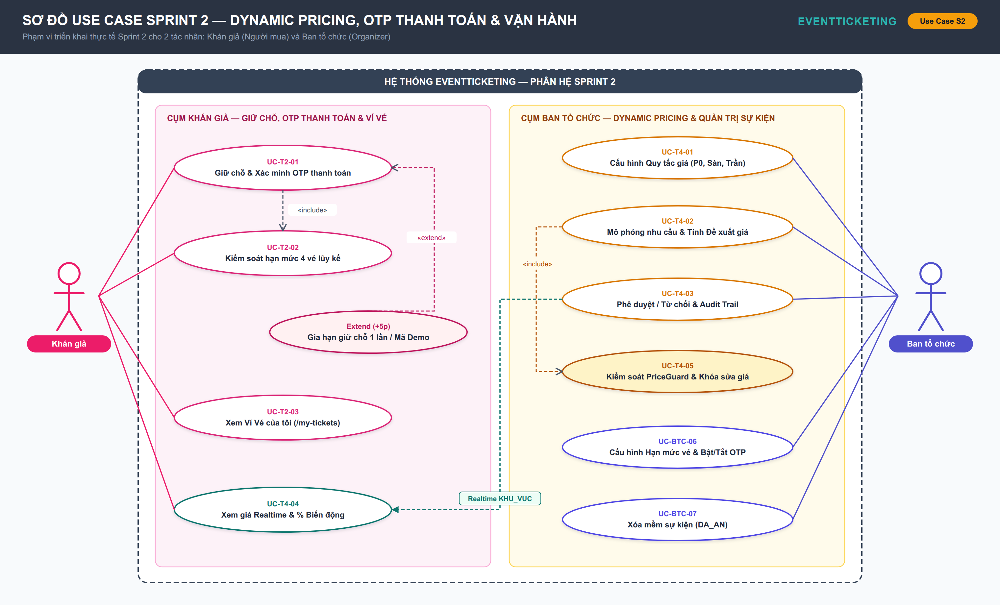

*(Vector: [uc_sprint2_overview.svg](./images/uc_sprint2_overview.svg))*

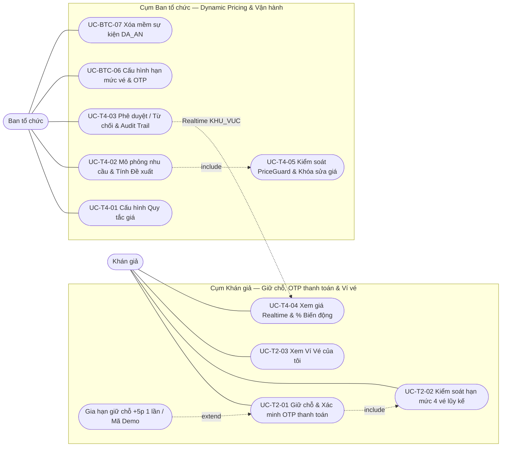

---

## 2. Activity Diagrams (Sơ đồ Hoạt động theo Swimlane)

### 2.1 ACT-S2-01: Giữ chỗ, Hạn mức 4 vé, Gia hạn 1 lần & OTP Xác nhận thanh toán

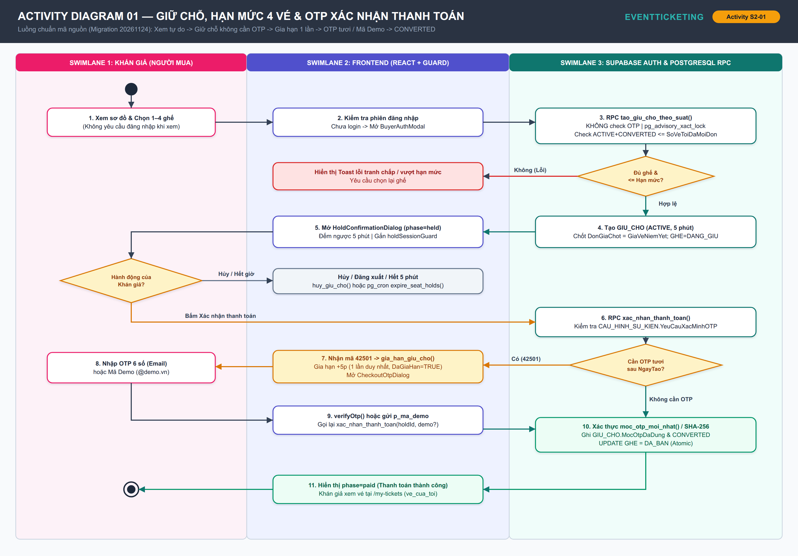

*(Vector: [act_s2_01_hold_otp_checkout.svg](./images/act_s2_01_hold_otp_checkout.svg))*

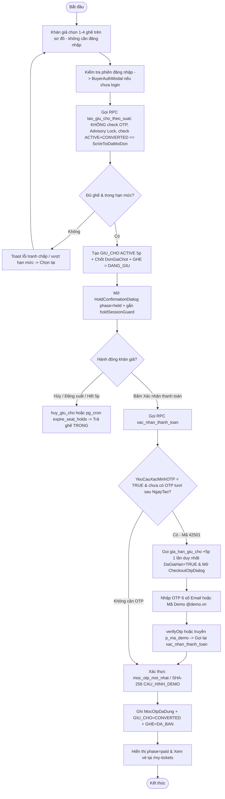

### 2.2 ACT-S2-02: Dynamic Pricing 5 bước, Mô phỏng, PriceGuard & Human-in-the-Loop

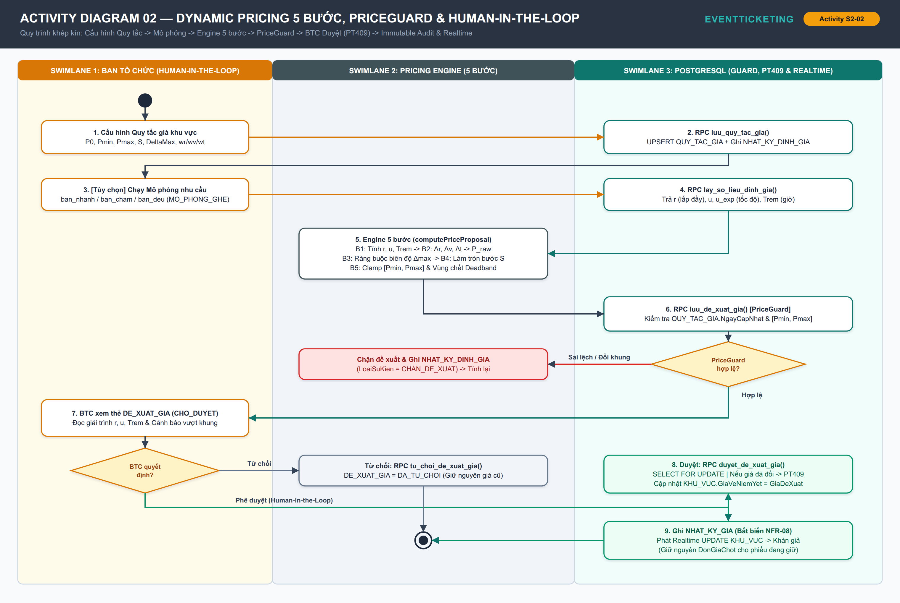

*(Vector: [act_s2_02_dynamic_pricing_guard.svg](./images/act_s2_02_dynamic_pricing_guard.svg))*

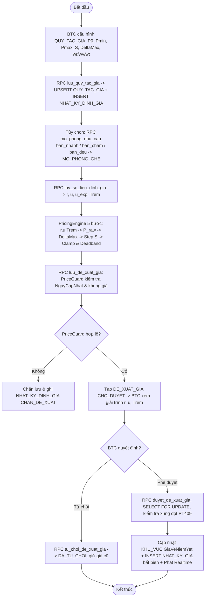

---

## 3. Sơ đồ Lớp Kiến trúc B-C-E (Class Diagrams)

### 3.1 Sơ đồ Lớp B-C-E Trọng tâm Sprint 2 (25 lớp)

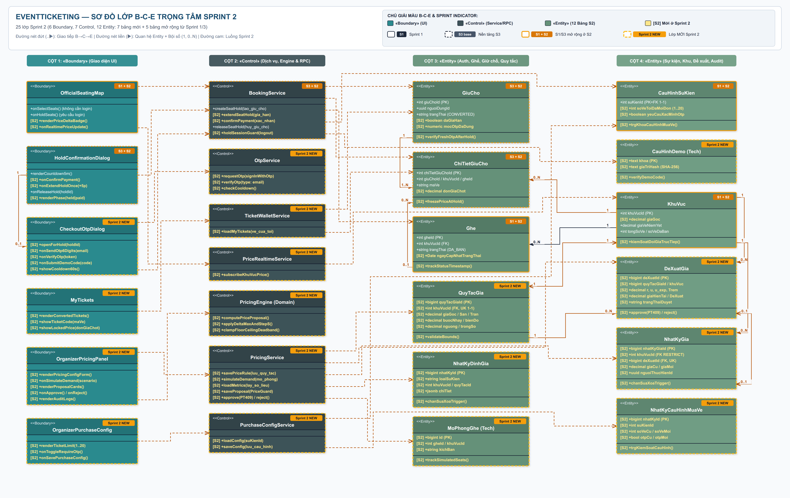

*(Vector: [cd_sprint2_bce_focus.svg](./images/cd_sprint2_bce_focus.svg))*

### 3.2 Sơ đồ Lớp B-C-E Toàn hệ thống Sprint 1 + Sprint 2 (41 lớp — 21 bảng Entity thật)

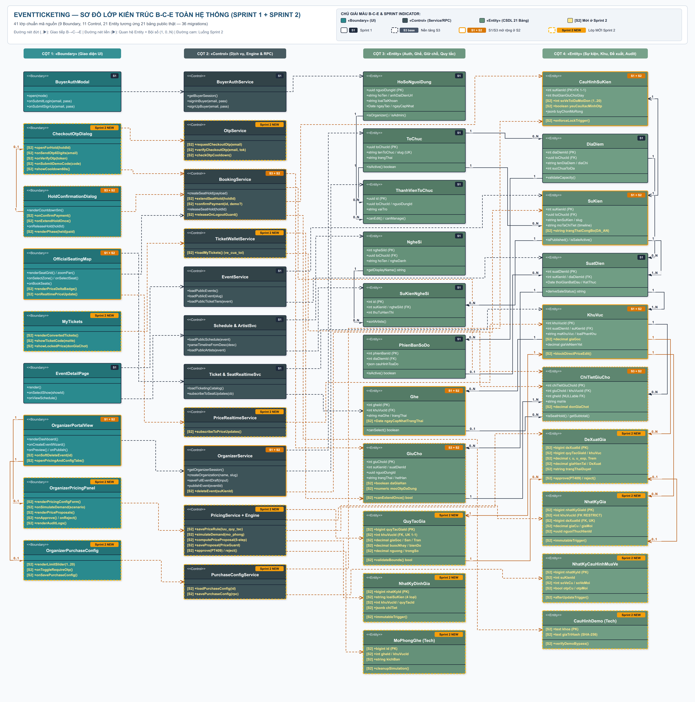

*(Vector: [class_diagram_bce_overview.svg](./images/class_diagram_bce_overview.svg))*

---

## 4. Sequence Diagrams Sprint 2 (4 sơ đồ chuẩn `:ObjectName` & B-C-E)

### 4.1 SD-S2-01: Giữ chỗ, Hạn mức 4 vé, Gia hạn & OTP Xác nhận thanh toán

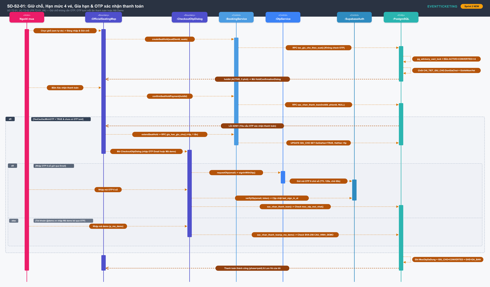

*(Vector: [sd_s2_01_hold_otp_checkout.svg](./images/sd_s2_01_hold_otp_checkout.svg))*

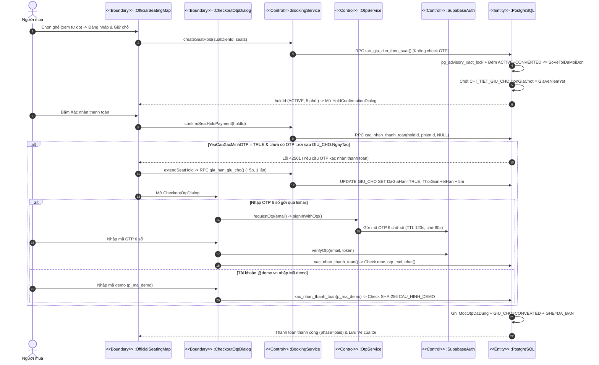

### 4.2 SD-S2-02: Dynamic Pricing — Cấu hình Quy tắc, Mô phỏng & Tạo Đề xuất (PriceGuard)

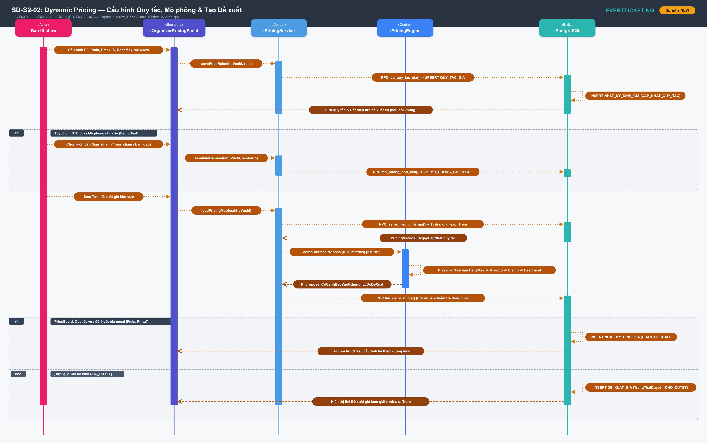

*(Vector: [sd_s2_02_dynamic_pricing_propose.svg](./images/sd_s2_02_dynamic_pricing_propose.svg))*

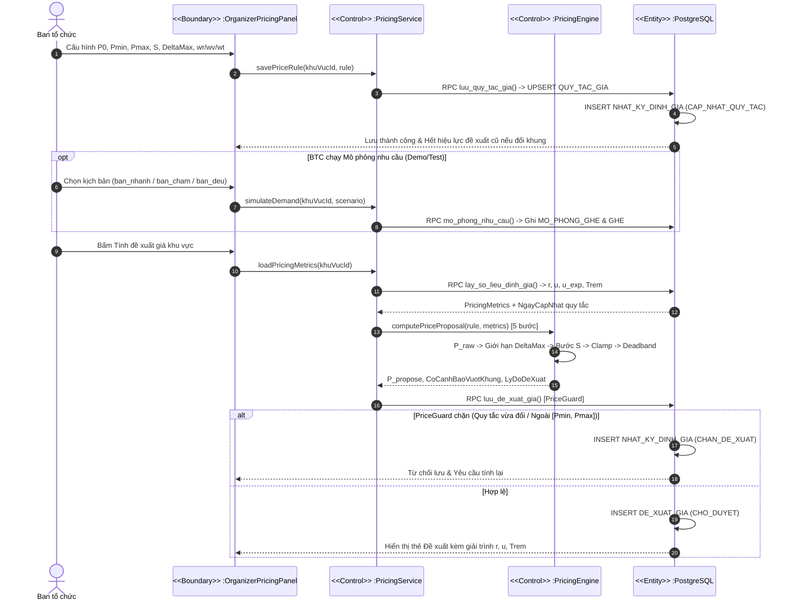

### 4.3 SD-S2-03: Dynamic Pricing — BTC Phê duyệt (`PT409`), Audit Trail & Realtime Giá

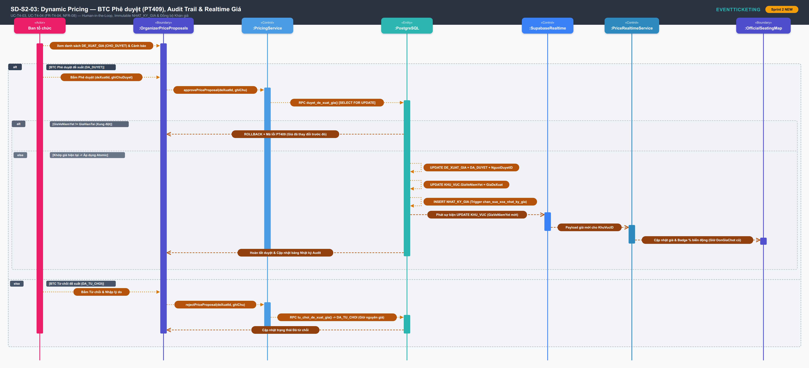

*(Vector: [sd_s2_03_dynamic_pricing_approve_realtime.svg](./images/sd_s2_03_dynamic_pricing_approve_realtime.svg))*

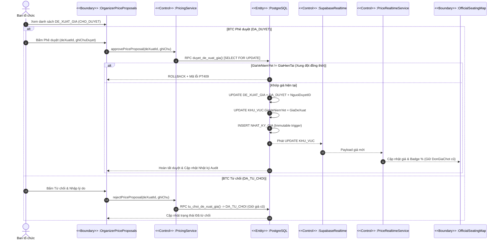

### 4.4 SD-S2-04: Cấu hình Mua vé (Audit), Ví Vé của tôi & Xóa mềm Sự kiện

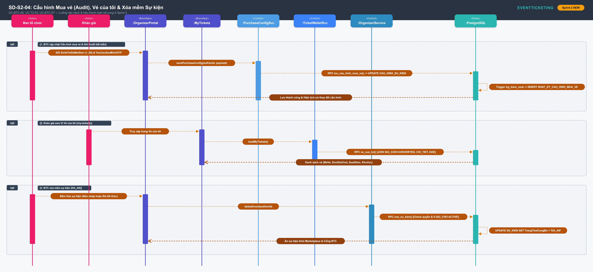

*(Vector: [sd_s2_04_purchase_config_wallet_soft_delete.svg](./images/sd_s2_04_purchase_config_wallet_soft_delete.svg))*

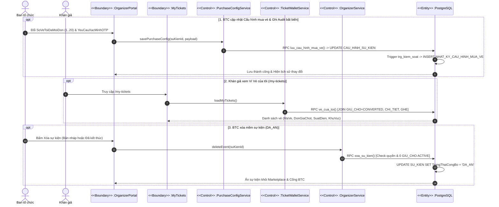
