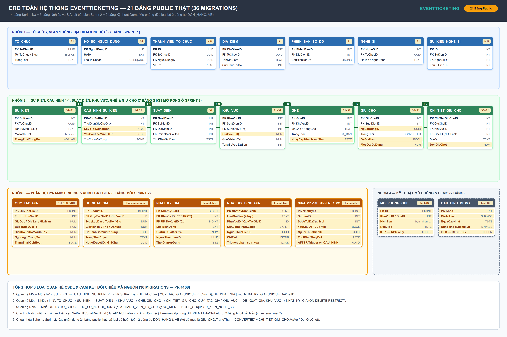
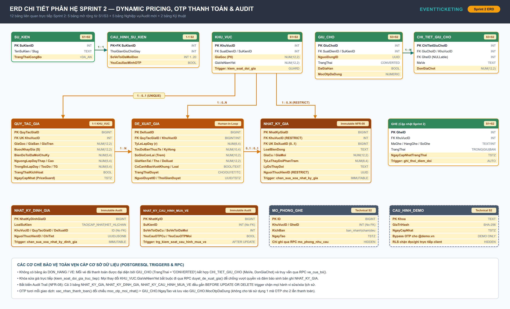
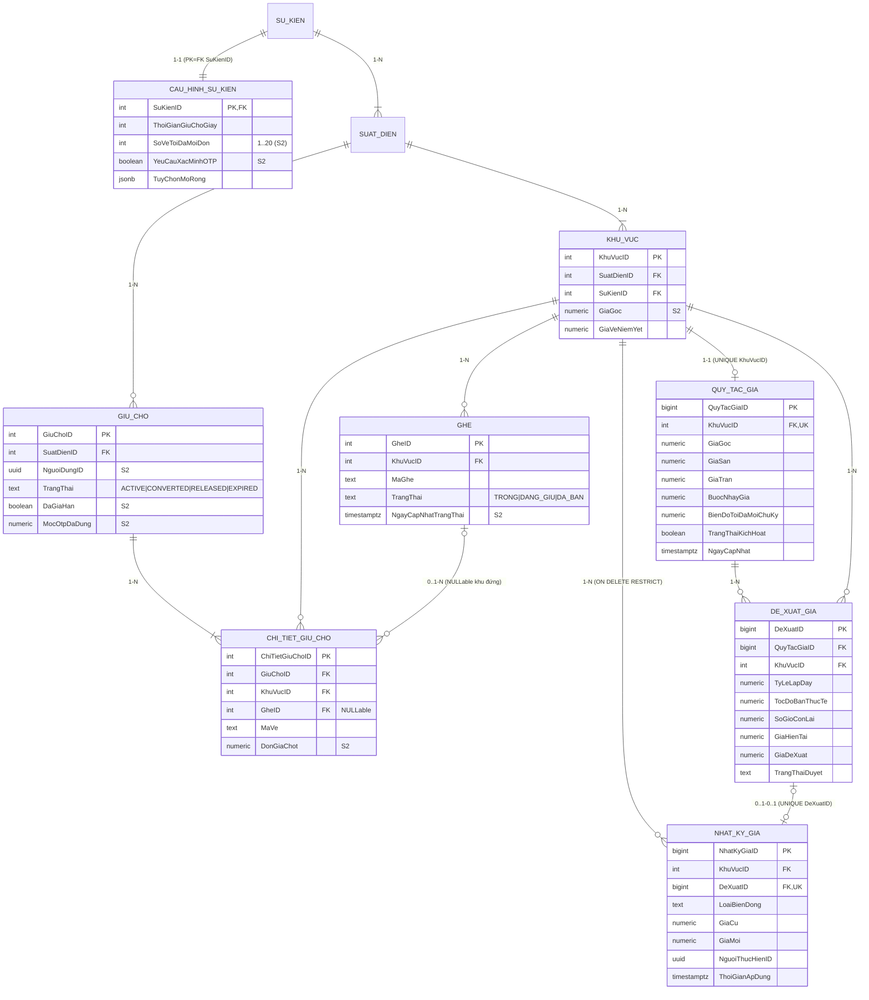

# 03 — Thiết kế Cơ sở Dữ liệu Sprint 2 (Đầy đủ 21 Bảng `public` thật)

> **Đối chiếu trực tiếp 36 Supabase migrations** trên nhánh `main` (PR #108, ngày 24/11/2026). Toàn bộ lược đồ gồm **21 bảng `public` thật**: 14 bảng Sprint 1/3 + 5 bảng Nghiệp vụ & Audit bất biến Sprint 2 + 2 bảng Kỹ thuật Demo/Mô phỏng. **Đã loại bỏ hoàn toàn 2 bảng ảo `DON_HANG` và `VE`** từng xuất hiện nhầm trong bản nháp kế hoạch ban đầu.

---

## 1. Sơ đồ ERD Toàn hệ thống (21 Bảng `public`)

*(Vector: [erd_full_21_tables.svg](./images/erd_full_21_tables.svg))*

---

## 2. Sơ đồ ERD Chi tiết Phân hệ Sprint 2 (12 Bảng liên quan trực tiếp)

*(Vector: [erd_sprint2_subsystem.svg](./images/erd_sprint2_subsystem.svg))*

---

## 3. Phân loại đầy đủ 21 Bảng `public` thật

| Nhóm | Số bảng | Danh sách bảng |
|---|:---:|---|
| **1. Nền tảng Sprint 1** | 12 | `TO_CHUC`, `HO_SO_NGUOI_DUNG`, `THANH_VIEN_TO_CHUC`, `DIA_DIEM`, `PHIEN_BAN_SO_DO`, `SU_KIEN` (+`DA_AN`), `CAU_HINH_SU_KIEN` (+`YeuCauXacMinhOTP`), `SUAT_DIEN`, `NGHE_SI`, `SU_KIEN_NGHE_SI`, `KHU_VUC` (+`GiaGoc`), `GHE` (+`NgayCapNhatTrangThai`) |
| **2. Giữ chỗ & Vé Sprint 3/2** | 2 | `GIU_CHO` (+`NguoiDungID`, `DaGiaHan`, `MocOtpDaDung`), `CHI_TIET_GIU_CHO` (+`MaVe`, `DonGiaChot`) |
| **3. Nghiệp vụ & Audit bất biến Sprint 2** | 5 | `QUY_TAC_GIA`, `DE_XUAT_GIA`, `NHAT_KY_GIA`, `NHAT_KY_DINH_GIA`, `NHAT_KY_CAU_HINH_MUA_VE` |
| **4. Kỹ thuật Demo & Mô phỏng Sprint 2** | 2 | `MO_PHONG_GHE`, `CAU_HINH_DEMO` *(0 FK, bị RLS chặn đọc/ghi từ client, chỉ truy cập qua `SECURITY DEFINER` RPC)* |
| **Tổng cộng** | **21** | **0 bảng ảo** (xác nhận không tồn tại bảng `DON_HANG` hay `VE`) |

---

## 4. Từ điển dữ liệu 7 bảng mới & các cột bổ sung Sprint 2

### 4.1 Các bảng mới Sprint 2

1. **`QUY_TAC_GIA`** (`20261112090000`): Quan hệ 1–1 với `KHU_VUC` (`KhuVucID INT NOT NULL UNIQUE`). Lưu `GiaGoc`, `GiaSan`, `GiaTran`, `BuocNhayGia`, `BienDoToiDaMoiChuKy`, `NguongLapDayThap`, `NguongLapDayCao`, `TrongSoLapDay`, `TrongSoTocDoBan`, `TrongSoThoiGian`, `TrangThaiKichHoat`, `NguoiCapNhatID`, `NgayCapNhat`.
2. **`DE_XUAT_GIA`** (`20261112090000`): Lưu thông số đầu vào (`TyLeLapDay`, `TocDoBanThucTe`, `TocDoBanKyVong`, `SoGioConLai`), giá (`GiaHienTai`, `GiaTinhToanTho`, `GiaDeXuat`), cảnh báo (`CoCanhBaoVuotKhung`, `LoaiCanhBao`), phê duyệt (`TrangThaiDuyet`, `NguoiDuyetID`, `LyDoDeXuat`, `GhiChuDuyet`, `ThoiGianDeXuat`, `ThoiGianDuyet`).
3. **`NHAT_KY_GIA`** (`20261112090000`): Nhật ký bất biến giá vé (`KhuVucID ON DELETE RESTRICT`, `DeXuatID BIGINT UNIQUE ON DELETE RESTRICT`, `LoaiBienDong`, `GiaCu`, `GiaMoi`, `TyLeThayDoiPhanTram`, `LyDoThayDoi`, `NguoiThucHienID ON DELETE RESTRICT`, `ThoiGianApDung`). Trigger `chan_sua_xoa_nhat_ky_gia` chặn mọi lệnh `UPDATE`/`DELETE`.
4. **`NHAT_KY_DINH_GIA`** (`20261113090000`): Nhật ký bất biến các sự kiện vận hành định giá (`TAO_QUY_TAC`, `CAP_NHAT_QUY_TAC`, `HET_HIEU_LUC_DO_DOI_KHUNG`, `CHAN_DE_XUAT`), không ràng buộc FK để giữ log ngay cả khi đối tượng thay đổi; bảo vệ bởi trigger `chan_sua_xoa_nhat_ky_dinh_gia`.
5. **`NHAT_KY_CAU_HINH_MUA_VE`** (`20261115100000`): Nhật ký bất biến mọi thay đổi `SoVeToiDaMoiDon` và `YeuCauXacMinhOTP`, chỉ được ghi tự động qua `AFTER UPDATE` trigger `trg_kiem_soat_cau_hinh_mua_ve` trên `CAU_HINH_SU_KIEN` và bảo vệ bởi trigger `chan_sua_xoa_nhat_ky_cau_hinh_mua_ve`.
6. **`MO_PHONG_GHE`** (`20261113100000`): Bảng kỹ thuật đánh dấu ghế được bán mô phỏng bởi RPC `mo_phong_nhu_cau` (`ban_nhanh`, `ban_cham`, `ban_deu`) để phục vụ kiểm thử & trình diễn.
7. **`CAU_HINH_DEMO`** (`20261124100000`): Bảng kỹ thuật lưu hash SHA-256 của `MA_DEMO_BO_QUA_OTP` dành riêng cho tài khoản `@demo.vn` khi chạy demo không gửi email thật.

### 4.2 Các cột bổ sung lên bảng Sprint 1/3

- **`CAU_HINH_SU_KIEN`**: thêm `YeuCauXacMinhOTP BOOLEAN NOT NULL DEFAULT FALSE`; gắn `trg_khoa_cau_hinh_mua_ve` + `trg_kiem_soat_cau_hinh_mua_ve`.
- **`KHU_VUC`**: thêm `GiaGoc NUMERIC(12,2)`; gắn trigger `kiem_soat_doi_gia_truc_tiep` chặn sửa trực tiếp `GiaVeNiemYet`.
- **`GHE`**: thêm `NgayCapNhatTrangThai TIMESTAMPTZ` tự động cập nhật bởi trigger `ghi_thoi_diem_doi_trang_thai_ghe` (phục vụ tính tốc độ bán thực tế `u`).
- **`GIU_CHO`**: thêm `NguoiDungID UUID`, `DaGiaHan BOOLEAN NOT NULL DEFAULT FALSE` (chỉ gia hạn +5p đúng 1 lần), `MocOtpDaDung NUMERIC` (chống dùng lại 1 mã OTP cho 2 giao dịch).
- **`CHI_TIET_GIU_CHO`**: thêm `DonGiaChot NUMERIC(12,2)` (chốt giá tại thời điểm giữ chỗ, bất biến khi BTC duyệt giá mới) và `MaVe` (không tồn tại cột `GiaTien`).
